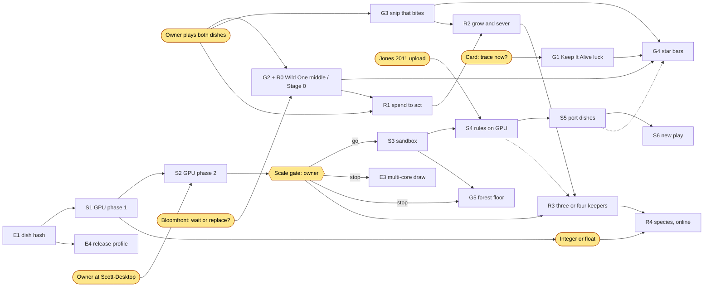

# Roadmap: every active plan in one order

Written 2026-11-10 18:15Z against `main` at `865c802`. It puts the four
plans that are running at once into one sequence, shows what each step
waits on, and names which project thread owns it. It adds no new plan: the
detail, numbers and gates stay in each plan's own source, linked below.
[HANDOFF.md](HANDOFF.md) is still the front page, and the owner's open
decisions are listed only there (wiki rule 5); this page points to them by
number.

The goal behind every line: interesting simulations that can be turned into
a game, not a realistic mould (owner, 2026-11-10 17:01Z). Fun over fidelity,
everything on screen is the simulation, and an outcome is a spread
([`wiki/decisions.md`](wiki/decisions.md)).

## The four plans

| Track | Plan | Owning thread | Source |
| --- | --- | --- | --- |
| **G** Game fixes | Keep It Alive's luck, The Wild One's middle, the snip, star bars, the forest floor | *Triage the previous session's hand-off* | Hand-off triage doc (https://claude.ai/artifact/XWm6u7y1UR3cfp2XxkhC7w); [HANDOFF.md, *Next steps*](HANDOFF.md) |
| **E** Engine checks and ports from Pixel_Physics | Dish hash, profiler, parallel draw, licence gates, keyed random draws, sound | *Review Pixel_Physics for reusable code* | Pixel_Physics review doc (https://claude.ai/artifact/Pe83NVdRMXhPvxeYoKASRu) |
| **S** Scale (GPU) | Six gated phases, from CPU foundations to new play at scale | *Research Sage Jenson's physarum work* | [`Reports/gpu-plan-2026-11-10.md`](Reports/gpu-plan-2026-11-10.md), [the mould at scale](wiki/model/scale.md) |
| **R** RTS (Bloomfront) | Five gated stages, from two keepers on today's dish to online play | *Explore turning the simulation into an RTS* | [`Reports/rts-design-2026-11-10.md`](Reports/rts-design-2026-11-10.md) |
| **L** Larder World | Six gated phases (W0-W5): growth on the GPU, a world with crystals, Larder in the world, several species, persistence, campaign; designed maps (WM1-WM5, owner 11-11 19:29Z) run beside W2 | *Larder* thread, with the GPU, creature, *Camera and UI* and *Player AI* threads | [`Reports/larder-world-roadmap-2026-11-11.md`](Reports/larder-world-roadmap-2026-11-11.md) (doc https://claude.ai/artifact/1N2NHKefAzKxUMZcr3ktjJ); owner ruling 11-11 14:06Z |

Thread names are the project's thread titles on claude.ai. When a thread is
closed, its track is unowned until a new thread takes it; say so in its row.

## The order

Four bands. Work in a band can run in parallel; a band starts when what it
depends on is done, not when the band before it is finished.

### Now: no owner input needed

| # | Step | Owner | Waits on | State |
| --- | --- | --- | --- | --- |
| E1 | Dish hash and determinism test | Pixel_Physics thread | nothing | done: PR #14 (`Dish::state_hash`, `every_dish_replays_bit_for_bit`, `mouldprobe` prints `hash=`) |
| S1 | GPU phase 1: frame profiler (also the review's E2), "GPU semantics" CPU arm, delayed-census arm, new rules off by default | GPU thread | E1 for the hash; owner go-ahead given 17:50Z | profiler done (PR #16: diffusion is 62% of the simulation, moving walkers 24%); arms measured on every dish: late census safe, fixed-point fields change play (fields stay `f32`), all-at-once move cuts seam fights (The Wild One's warden loses, p 0.0005); owner 20:55Z: today's dishes are not the true games, so gates use engine measures; scaling rule chosen 11-10 on 16 paired seeds (`mould::big`, `examples/bigdish.rs`): today's numbers in fine cells plus food smelled at today's reach; more steps a frame rejected. **Done** |
| E4 | Release profile re-measured on `mouldprobe` and one CI run | Pixel_Physics thread | E1 | done: `codegen-units = 1` kept (about 0.45 ms a frame), thin LTO dropped (no gain); hashes unchanged |
| L-AI | Player AI for Larder playtests (`src/mould/larder_ai.rs`, `src/mould/larder_world_ai.rs`, `examples/larderai.rs`, `larder -- SEED ai=STYLE`) | Player AI thread | nothing | **built 11-11** on the CPU field: [report](Reports/larder-ai-2026-11-11.md), [page](wiki/world/player-ai.md). Plays through `Cmd`s only, sees a `View`, one brain per `Side`; five styles; boom, lure and adapt beat idle and random 16/16 held out. **Ported to the Larder world 11-12** (`src/mould/larder_world_ai.rs`, hands in `examples/larderworld.rs`): [report](Reports/larder-world-ai-2026-11-12.md); boom, claim, late, fort beat the scripted farm 15-16/16 held out, strike wiped the mould once. Next: the tier counter tests (Sporer, Sleeper, Swarmer), `mould_grid` on the GPU world, two AI teams once a second side exists, exploiter search |
| E5 | Licence and notices gates, the JetBrains Mono OFL notice, `crispfont.py` | Pixel_Physics thread | nothing; must land before any build leaves the owner's machine | done: `scripts/licensecheck.sh`, `scripts/notices.sh` + `THIRD-PARTY-NOTICES.txt`, `notices.yml`, `scripts/crispfont.py` |
| R- | Bloomfront research (six brainstorm agents, then a red team, then a field retest and verb census) | RTS thread | nothing; design only | **done 11-10**: [red team](Reports/rts-design-2026-11-10/red-team/README.md), [field retest](Reports/rts-design-2026-11-10/field/README.md), [page](wiki/rts/directions.md). On The Wild One Taut fails and the counters are a ladder; on a 23-pile field Taut's pull wins and the counters cycle on one layout of two. Census: field salt passes on share; Wild One lamp moves share but not by 0.02. Later: the cycle holds on 1 layout of 10; salt overturns a 60 s lead on scatter. Now two demos (R-S, R-F) |
| R-S | Field skirmish playable demo (`src/mould/skirmish.rs`, `web/`) | RTS thread | nothing | v1 done and set aside by the owner (21:14Z); **v2, the budget skirmish, in the harness 11-10**: [report](Reports/rts-skirmish-2026-11-10.md), [page](wiki/rts/skirmish.md). Soft beats all 8 other plans 127/128, no cycle. **v2 page live 11-10**; round 3's counterplay rules (rally, rising spore price) did not stop soft (124/144). **Rounds 4-6 done 11-11**: side edge fixed; model changes (holder's bonus, supply lines, size upkeep, desperate fights) do not dethrone soft and keep; desperate fights ease the snowball. **Rounds 7-7b done 11-11** (economy sketch tests 1, 3 and half of 4): food after 1:00 and a held-ground score leave the 1:00 leader winning 80-85%; regrowth cuts wipe-outs; a counted-down Strike with a Fortify that kills attackers dethrones soft, but brace (strike and fortify) wins every pairing; page opens on Strike and Fortify. Next: Fortify's price and the exploiter search against brace |
| R-F | Two Fevers playable demo (`src/mould/fever.rs`, `fevers-web/`) | Two Fevers thread | nothing | **v3 done 11-10**: [report](Reports/two-fevers-2026-11-10/README.md), [page](wiki/rts/two-fevers.md), https://claude.ai/artifact/UMzPJmevoYJYmx8KRqG37a. Calls, fever by tube, foraging, pinch. Plans form a ladder (trunk > web > raider), not a cycle; the leader keeps the lead; waits on the owner's hand |

### Next: waits on the owner

| # | Step | Owner | Waits on |
| --- | --- | --- | --- |
| P | **Play Keep It Alive and The Wild One by hand** | Scotttt | nothing. This is the one step that unblocks most of the rest |
| G1 | Keep It Alive: trace single games to find what sends one into the short or long hump. Measures only; the game does not change | Triage thread | **done 11-10**; owner picked "Trace it now" (card, 18:56Z): the first pile on mostly-asleep mould decides it ([report](Reports/mould-keep-alive-luck-2026-11-10.md)). Next: a 20 s landing preview, a game change |
| G2 + R0 | **The Wild One's middle (seconds 30 to 150), done as Bloomfront Stage 0.** First separate which of lamp, snip and oats needs the aim; then give the wild mould a scripted hand on a mirrored dish | one thread, to be chosen | P for G2; the owner's say for R0 (HANDOFF decision 7, "wait or replace") |
| G3 | The snip: make a cut-off piece visibly starve, or take it off The Wild One | Triage thread | P |
| E6 | Keyed random draws and the dead-dish slowdown | Pixel_Physics thread | timing only: see *One census reset*, below; the keyed draw itself is built inside S1 (`keyed`, used only with `Params::all_at_once`, off by default) |
| E7 | Sound for the game, from Pixel_Physics's `src/audio/` | Pixel_Physics thread | **built 11-10** (owner: "yes to sound", 19:22Z; [report](Reports/mould-sound-2026-11-10.md)). Next: the owner's ears on the Mould Sound page |

### Then: the scale fork

| # | Step | Owner | Waits on |
| --- | --- | --- | --- |
| S2 | GPU phase 2: offline 1024 x 640 with about 100k walkers, paired seeds; GPU timing test | GPU thread | offline dish **done 11-10** on the engine-only dish (economy left out under the owner's 20:55Z ruling): 32k and 100k walkers, videos and counts on the [4x Mould page](https://claude.ai/artifact/WMfUwTj9Dfdwp9MCfy8MHs). Timing test built (`examples/gputime.rs`: four wgpu compute passes a tick; on a software GPU its dish matches the CPU's, 165 loops against 163 at 100k). **Timing done 11-11** on the GTX 1070 through Remote Control: 100k walkers take 1.37 ms for a frame of two ticks, 1M (no crowd limit) 3.52 ms, against the 8 ms bar; the GPU dish matches the CPU's (115 loops against 114 at 20 s) ([plan, *GPU timing on the GTX 1070*](Reports/gpu-plan-2026-11-10.md)). *Review 11-11:* one seed, and that was the gate's timing part only; raw now kept |
| **Gate** | **The owner picks a target scale and look, or stops** | Scotttt | **decided 22:32Z** (card): 100,000 walkers on 1024 x 640; the GPU timing passed on 11-11, so the GPU goes ahead to S3. The owner asked (11-11 00:06Z) for every option the Jenson comparison tested as a sandbox control: that is S3 |
| S3 | GPU phase 3: the sandbox, every Jenson-comparison option as a control | GPU thread | **built 11-11** (`cargo run --release --bin mouldgpu`, [report](Reports/gpu-sandbox-2026-11-11.md)); on the GTX 1070 100k walkers take 1.45 ms of GPU a frame with drawing, 1M 8-10 ms ([page](https://claude.ai/artifact/1rdrxadVcNdxTmbxp2KJGy)). The twin test runs in CI on software Vulkan (one GPU tick against one CPU tick, to the bit on keys 1, 3, 4 and 5). **Independent review 11-11:** fed scent and jumps after the step added on the GPU; then on 8-16 seeds, on the software GPU and the 1070, no measure differs from the CPU after Bonferroni (report, *Independent review*). **Looks as controls 11-11:** the looks thread's rules (disc and haze, trail-set settings, deposit cap, floor, wander, contagion) on two panel pages and keys 9, 0, Shift+1-5, twin-tested on six dishes (to the bit on four, within 1.1e-7 with the cap; corrected 11-11); off they cost 0.01 ms a frame on the 1070, contagion 0.3 ms at 100k. **Outside rules as controls 11-11:** species (bands, cyclic, conversion, species 0's boost), explorers, blocked lay and keep, chance turn, size spread, area sensors, grazing; a fourth panel page and Shift+6-0, Ctrl+1-2; twin-tested on fifteen dishes (every walker, age and species; fields within 2.4e-8); compiled out when off. Next: the 1070's timing of these; the owner's hands; the tools as field writes. `species_share` and the other species rules are on the GPU engine (W3a) |
| W0 | Larder World: growth and starving per walker, CPU and GPU twins | GPU thread | **merged 11-11 (#73)** ([report](Reports/growth-2026-11-11.md), [wiki](wiki/model/growth.md), [page](https://claude.ai/artifact/EGgjauGkFxneuSRz8zTBei)): off by default; the GPU matches the CPU in a one-tick twin test in CI; fed 96,358 against starved 428 alive at 30 s (8 of 8); on the GTX 1070 +0.16 ms on a 1.82 ms frame at 100k; sandbox GROWTH page. With W1a merged: a walker's crystal take is food. On crystals size follows crystal area, not charge ([mould shape](Reports/mould-shape-2026-11-11.md)); `energy_flow` (CPU, off) turns the hoard into 15-24% more walkers. A GPU grazing-count fix (counts cleared only with `graze_w`) followed in its own PR |
| W1a | Larder World: crystals (run dry or refill, flow inside, hexagons), rock and wet terrain, rect world, player walls with health that leak scent; CPU big dish | Larder thread | **done 11-11**, PR #64 ([report](Reports/larder-world-roadmap-2026-11-11.md): defaults `wall_hp` 400, `wall_scent` 0.9, `crystal_flow` 0.01; with growth, charge sets how long the mould lasts, not how big it gets) |
| W1b | Larder World fields on the GPU engine (crystals, walls, terrain), checked by the CPU/GPU twin test | Larder thread (agreed with the GPU thread 11-11 17:02Z) | **built 11-11** ([report, *W1b*](Reports/larder-world-roadmap-2026-11-11.md)): one GPU tick matches one CPU tick on nine world dishes (fields within 3e-9, bits exact), a wall built on the GPU matches the CPU's, and all 17 planted bugs are caught. On the GTX 1070 the world adds 0.25 ms to the frame at 1024 × 640 (1.73 to 2.11 ms, three runs). PR #74, after #63 and W0 (both merged); #69 rebases on it |
| W1c | Crystal sizing on a world big enough that an idle mould keeps growing for minutes (the race start); crystals of different sizes | Larder thread | Folded into W2b (11-11): the idle hand on the W2 world, measured with the game's own harness, is this test |
| W2a | Larder in the world, engine hooks: per-unit touch, densest mould and harvest (`squad`), soldier smell, shots that stop at the first mould and strike | Larder thread | **built 11-11** ([report, *W2a*](Reports/larder-world-roadmap-2026-11-11.md)): one GPU frame matches `squad::frame` on the CPU exactly (16 shots, 15 units), all 16 planted bugs caught after the test was strengthened twice; on the GTX 1070, 8 and 40 units add 1.0-1.5 ms to a 2.1 ms frame at 1024 × 640, most of it the units pass's one thread a unit (to cut in W2c). Bodies as crystals move to W2b. PR #74 |
| W2b | Larder in the world, game layer: M3's rules over the world (orders, stances, harvesting crystals, walls, buying, replays) | Larder thread | **built 11-11** ([report, *W2b*](Reports/larder-world-roadmap-2026-11-11.md), [page](https://claude.ai/artifact/XJa5MHiudUsVVnUwyaXHLP)): `mould::larder_world` on the CPU race world and `gpu::larder_world` on the engine (`scale` engine ticks a game tick; a GPU test keeps the two moulds within 8% over 20 s). Soldiers walk distance maps round rock and fire only along a clear line (the first census had a rush put 196 of 200 shots into rock). Gate passed on held-out seeds 5-20: idle and random lose 16/16; farm and wall beat both 16-0 (p < 0.0001, Holm); no hand wipes the mould, one wall adds nothing over farming, a rush dies. Score v2 (11-12): a stalemate scores the charge taken and the mould's size; the gate still holds 16-0, the dry-crystal rule is on, and the fixed farm hand harvests twice the food. Turrets, bait, hunger and bodies not ported; the units-pass speedup moves to W2c |
| W2c | Larder in the world, the window: camera, controls and marks (#63), the look (#69), the game UI (#80), on `GpuWorld` | Larder thread, with the Camera and UI and graphics threads | **first cut built 11-12** ([report, *W2c*](Reports/larder-world-roadmap-2026-11-11.md)): `cargo run --release --bin larder-world -- map=fork` plays W2b's game on `GpuWorld` on a v2 map, with the camera, look, UI and real shots (rays to the first slime, kills, wounds); the owner's `mouldgpu` playtest had found the UI's stand-in squad, which has no rules. Two fixes rode along: no specks for dead walker slots, and the game's cuts leave the look's wound. The ground rebuild is down to 1.7-1.8 ms (11-12). Soil plays on the GPU since 11-12 (WM3). Left: the frame time on the 1070 (the window prints p95 every 10 s), the units pass and non-blocking read-backs if it shows the need; gate: the owner plays it, frame under 10 ms p95 on the 1070 |
| W3a | Larder World, several species on the GPU engine: the creature thread's species rules (species 0's share, conversion weighed over a square, a second kind of walker in one mould, each species' own settings), then the tiers' life cycle (spores, a dormant crust, the alarm, the strike) | GPU thread (agreed with the creature and tiers threads 11-11) | **Species settings built 11-11** ([report](Reports/species-gpu-2026-11-11.md)): off by default; one GPU tick matches one CPU tick on 12 dishes and a growth dish, every row sum of the square matches the CPU's, and all 28 planted bugs are caught; on the GTX 1070 they cost nothing off, two species pay 0.05 ms a frame more (2.08 to 2.13), the second kind 0.12-0.19 ms, and the square of radius 8 1.3 ms of a 2.3 ms frame. A W1b fix rode along: a wall built with growth on moved the empty slots under it (the wall twin test gains a growth dish). **Life cycle built 11-12** ([report](Reports/life-gpu-2026-11-11.md); the owner asked 11-11 20:12Z, through the tiers thread, for the tiers in the game): spores, dormancy and dying asleep (`sleep_death`), the alarm field, the player's strike and the squad shots' alarm on `gpu::Engine` under the CPU's keys (`Tier::settings`, the sandbox's `tier=sleeper`), off by default, no new binding. One GPU tick matches one CPU tick on 18 dishes (the three tiers among them), the squad's frame on four, and 74 of 77 planted bugs are caught (the other three harmless, or a race software Vulkan cannot show). Off it costs nothing measurable on the software GPU; on, the life passes take 2.6 ms a tick there at 100,000 walkers (`fate` 2.2). Next: the 1070's timing; the tiers in the GPU world game |
| L-T | Larder World: mould tiers on the ladder (Sporer, Sleeper, Swarmer): a life cycle per walker and an alarm the player's fire lays, on the CPU big dish; `mould::tiers::Tier` names each for W2b | Mould tiers thread; the GPU port is W3a's | nothing. **Built 11-11** (#70, then the world re-test: [report](Reports/mould-tiers-2026-11-11.md), [reviews](Reports/mould-tiers-review-2026-11-11.md), [wiki](wiki/world/mould-tiers.md)). In the world race the Swarmer and the Sleeper's bait hold 8 of 8; the Sporer's edge is not significant. On the GPU engine too since 11-12 (W3a). Next: counters against random and idle hands with W2b's player AI; review 2's candidate tiers (supply lines, habituation) |
| WM1 | Maps: a map file and loader. A map is pictures plus a short text file: ground kind per cell (agar, rock, wet, wall and its health), crystal centres, sizes and charges, the mould's start and the squad's start. It loads into the CPU big dish and the GPU engine, and today's noise worlds can be saved as maps | Larder thread (it writes W1b's fields) | **built 11-11** ([report, *WM1*](Reports/larder-world-roadmap-2026-11-11.md)): `mould::map` reads `maps/<name>.png` (G: wet, rock, soil) and `.txt`; `BigDish::with_map`, `Engine::with_map` and `GpuWorld::with_map` build the world with each crystal its own size and charge, the blob on `mould`, the larder on `landing`, walls with their health; `larderworld map=NAME` runs a census on a map. Gate passed: the v2 Fork and Nest play within 1% on the CPU and the GPU (soil off on both), and a saved noise world loads back hash-identical. Found on the maps: a blob by the rim placed 3,752 of 5,000 (fixed); a soldier waits at a dry crystal for a full load (open: four rules that send it home each cost the planned hands, since the score counts a crystal with crumbs left as held). Soil on the GPU too since 11-12 (WM3's GPU side) |
| WM2 | Maps: the first designed maps, three to five, each made for a different plan (for example a race out of one corner, a choke between rock with crystals behind it, ground split by wet land, a world that is mostly mould) | *Design Larder world maps* thread, with the Larder thread | Planned 11-11 ([plan](Reports/larder-maps-2026-11-11.md): five paper maps, each drawn for a different winning style; loader files in `Reports/larder-maps-2026-11-11/maps/`). Waits on WM1 and W2b's harness. Gate per map: idle and random hands lose; across the maps the winning plan changes (a map one plan wins everywhere adds nothing) |
| WM3 | Maps: ground kinds the simulation uses, beyond rock, wet ground and rubble. Brainstormed from the model (what walkers and fields can respond to: step speed, how fast trail and scent fade or spread, where walkers may lay trail, food that grows back, ground the mould changes as it passes), not from the demo tools. Each kind is a field, twin-tested on CPU and GPU, and kept only if it changes a measured outcome and can be seen | *Design Larder world maps* thread; GPU side with the Larder thread | Ranked 11-11 ([plan](Reports/larder-maps-2026-11-11.md)). **Height parked** (owner, 20:06Z: "How much does height actually influence our slime mold behaviors? I am skeptical how much fun/complexity/strategy this adds"): the first step is sand, clay and barren ground, which act on the mould's strong terms, on paired seeds with wet ground as the speed baseline (maps thread, CPU big dish, off while no soil is set); then rebuild the maps on the graphics thread's terrain (#69). Ground word: soil kind in bits 12-15, mould-made ground 16-23, byte 3 reserved for height and left 0. **GPU side built 11-12** ([report, *Soil on the GPU*](Reports/larder-world-roadmap-2026-11-11.md), [page](https://claude.ai/artifact/1ifC4Qrw6fXe5Aq7vVSRzZ)): the engine reads the kind from the ground word and plays the CPU's three rules. One tick on soil bands matches the CPU to the bit, and the four soil maps' game twin stays within 2.1%. In the window the Rim's sand ring now holds the mould in its clay core. No step cost on software Vulkan |
| WM4 | Maps: the ground's look, drawn from the ground's fields (the picture is the data). #69 gives rock, wet ground, walls and crystals height and light; open agar is still dark because nothing is stored there but trail and scent, so WM3's fields are what the open ground can show | graphics thread | #69, WM3 |
| WM5 | Maps: an editor in the window (paint ground kinds, place crystals and starts, save, play) | to be chosen | WM1, W2c. Later: W4's persistent world and W5's campaign are made of these maps |

The two branches after the gate:

| | If the GPU goes ahead | If it stops |
| --- | --- | --- |
| Drawing | E3 (multi-core renderer) is dropped; the GPU draws | E3: port the Pixel_Physics multi-core row renderer |
| Engine | S3 sandbox (read Bleuje, Lague, PolyPhy first), S4 game rules on the GPU (needs Jones 2011 uploaded), S5 port the dishes that survive | stay on the CPU |
| Forest floor (G5) | built after S3, as a large world | built small on the CPU |
| Bloomfront Stage 3 (three or four keepers, big map) | on the GPU; the rival becomes a second whole dish in S4 | the plate-and-colonies split on the CPU, frame under 10 ms on the owner's machine |

### Last

| # | Step | Owner | Waits on |
| --- | --- | --- | --- |
| G4 | Star bars re-checked on 16 or more seeds | Triage thread | G1-G3; and S5 if the GPU goes ahead, because S5 re-derives the bars anyway |
| R1-R2 | Bloomfront Stage 1 (spend to act; needs a currency first, since the food store sits at a median of 0, [brainstorm](Reports/rts-design-2026-11-10/brainstorm/README.md)) and Stage 2 (grow and sever) | RTS thread | R0's gate (equal hands 45-55%, sharp beats clumsy on 16 paired seeds); P (Stage 1's gate needs the owner's play); G3 (Stage 2's sever is the snip that bites) |
| R3-R4 | Bloomfront Stages 3 and 4 | RTS thread | the scale fork; Stage 4's lockstep needs the integer simulation (HANDOFF decision 6) |
| S6 | New play that only scale allows | GPU thread | S5 |
| G6 | Later depth, in the owner's order: melting salt, spores, a rival the player steers, same-kind moulds joining | unowned | G1-G4 playing well |

## Dependencies

Yellow is the owner. A dotted arrow is "if the GPU goes ahead".

## Where the plans touch each other

These are the places two threads could step on each other or redo work.
Each has a rule.

- **One census reset, not three.** Three changes would each make every old
  census number stop reproducing: the keyed random draws (E6), the
  all-integer simulation (S1's decision), and the GPU path itself (S5). They
  are the same idea: a random draw keyed on seed, walker and step is exactly
  what the GPU plan's integer design uses. So build E6 as part of S1, in the
  form the GPU plan needs, and land it in one reset together with the
  integer switch if the owner agrees to it. Land it between reports, never
  while G1 or G2 are mid-measurement, and re-run every dish's baseline once
  in the same PR.
- **Parallel draw is on hold.** The Pixel_Physics review puts the
  multi-core renderer third; the GPU plan holds it until the scale gate,
  because GPU drawing would replace it. Hold it (HANDOFF decision 6); it
  becomes the fallback if the owner stops at the gate.
- **The profiler is built once.** E2 and S1's profiler are the same tool;
  the GPU thread builds it.
- **The Wild One has one owner at a time.** G2, G3 and Bloomfront Stage 0
  all change The Wild One. The RTS report's own advice is that Stage 0
  answers G2's question, so do them as one piece of work in one thread.
  Which thread is the owner's call with decision 7.
- **`src/mould/mod.rs` is busy.** E1, S1 and E6 all edit it. Land E1 first;
  S1 builds on it.
- **The snip matters twice.** G3 is a game fix and Bloomfront's Stage 2
  depends on it (supply raids). Its report should say whether a sever now
  starves the far side, measured both ways.
- **Determinism is shared.** E1's dish hash is S1's first gate and
  Bloomfront Stage 4's lockstep check. All three use the same hash.
- **The forest floor needs two engine fixes** whichever branch is taken:
  stepping only near the mould (one open 256 x 160 floor costs about 1 ms a
  step), and `spread` still skipping the border row
  ([`Reports/mould-real-world-2026-11-09.md`](Reports/mould-real-world-2026-11-09.md), §5;
  hand-off triage). No thread owns it yet.

## What waits on the owner

In the order that unblocks the most. The numbers are HANDOFF's open
decisions.

1. **Play Keep It Alive and The Wild One.** Blocks G2, G3, G4, Bloomfront
   Stage 1's gate, and most of decision 1.
2. ~~Answer the trace card~~ (decision 1): answered 18:56Z, "Trace it now";
   done. What follows from it, a 20 s landing preview, changes the game and
   waits on the owner's go.
3. **Bloomfront's three questions** (decision 7): wait for the queued work or
   take over The Wild One's next steps; fog of war drawn from a held
   quantity; two keepers or three-to-four. Recommended: do G2 as Stage 0.
   *Since the red team (11-10):* Stage 0's gates would pass without testing
   the opening, so the RTS thread recommends a paired-clone verb census
   first; G2 can still use Stage 0's two-keeper plumbing.
4. **Hold the multi-core renderer** until the scale gate (part of decision
   6). Recommended: yes. Needed now, because it is third in the Pixel_Physics
   thread's order.
5. **Listen to the Mould Sound page** (https://claude.ai/artifact/6GXBj1swj93DzdytbUjqvA) and say whether the levels are right.
6. ~~**Be at Scott-Desktop with the Claude app open** when S2's timing test is
   ready.~~ Done 11-11; the owner gave a standing OK (00:06Z) for tests on
   that PC whenever it is reachable.
7. **Integer or float** (decision 6), after S1 has measured it. Recommended:
   integer.
8. **Upload Jones 2011** before S4.
9. **The scale gate** after S2.
10. Low urgency, best answered after playing: retire F7 and grains or
    glints (decisions 2 and 3), food flow (4), the Organ and the Wanderer (5).

## Keeping this page true

- A thread that passes a gate, opens or merges a PR for a step, or changes
  a step's owner updates its row here in the same PR.
- An owner answer moves into [`wiki/decisions.md`](wiki/decisions.md) as
  usual; then update the row it unblocks here.
- The GPU go-ahead (17:50Z) and the owner's GPU (GTX 1070 on Scott-Desktop,
  17:54Z) are recorded in `decisions.md`.
- Each thread merges its own PRs once both CI jobs are green on the exact
  head, with a merge commit (owner, 17:47Z). Any new report must be cited
  from a wiki page in the same PR; `python3 wiki/lint.py` fails otherwise.
