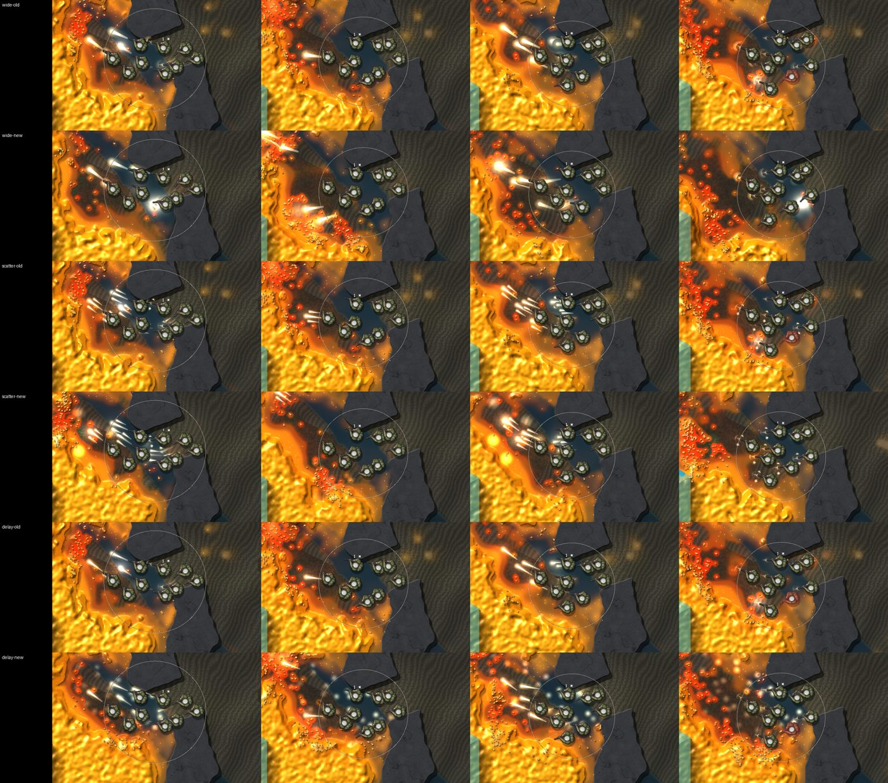
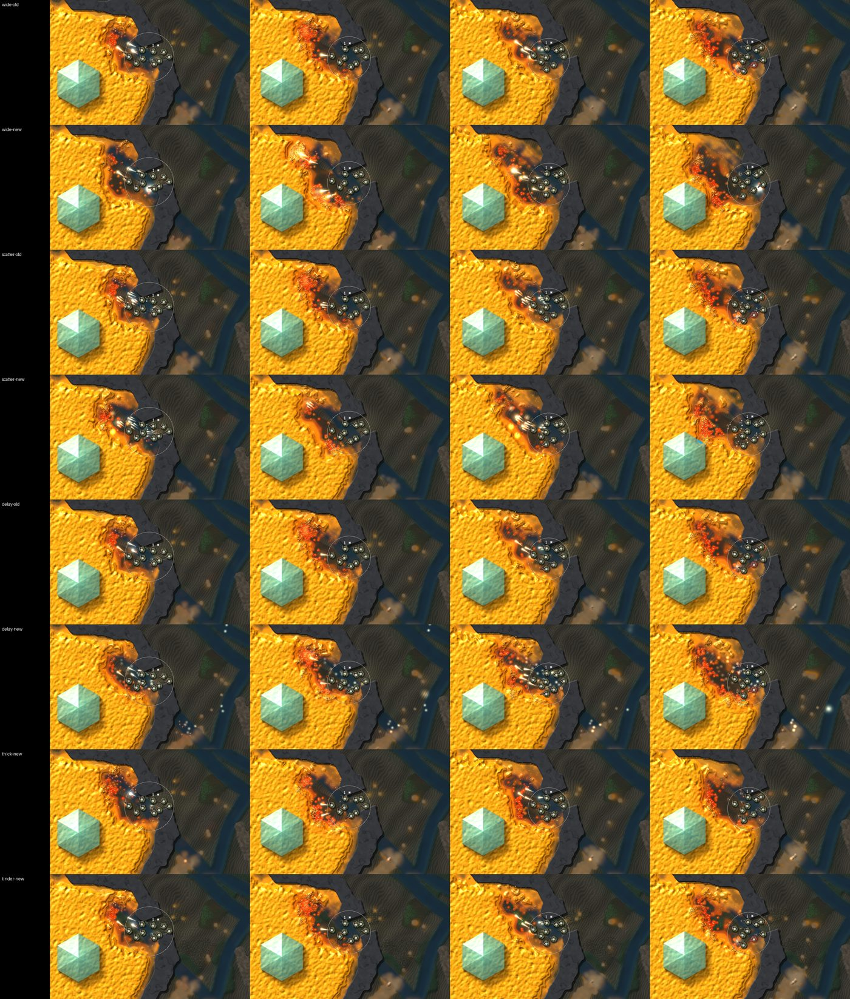
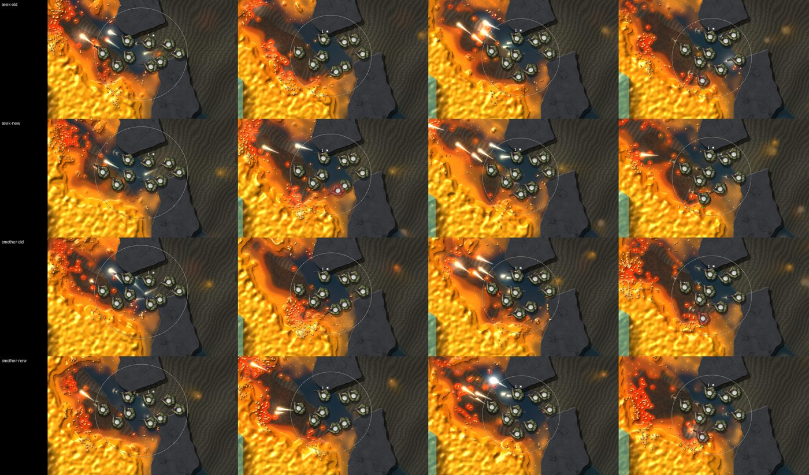
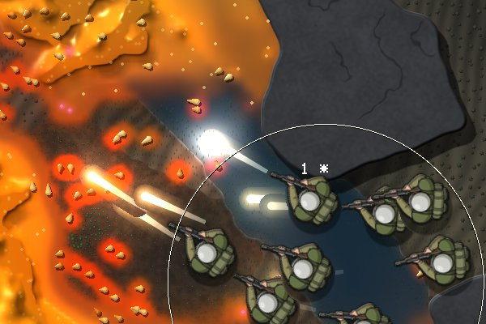

# Every shop gun card visible (exit test 5), 2026-11-22

Squad and arsenal, for Direction's test 5 job: film the starting rifle and
each card on planet 1's shop, list any card whose effect can't be seen, and
fix the dead ones without making a lone card overpowered (the owner's Noita
rule). The fix is the pull request that adds this folder.

## How it was measured

The gun lab's arena (`larder-world gunlab=1:SEED:60 deck=CARDS arena=9
tail=10`): nine soldiers bought at once on planet 1's real slime, 60 s of
fire and a 10 s tail, one squad that is not the controlled one (so its
strike sits under the engine's cap). Seeds 1 to 4, kills summed, against the
plain rifle's 5,753 (1,985 / 1,446 / 954 / 1,368). Software Vulkan in the
cloud; counts, not timings. `an.py FILE` prints each deck's paired
differences against `raw-main.txt`.

Films: `look=DIR run=1:1 mode=squads hand=edge bank=2000 load=1,DECK
centre=squad,Z at=27.0..28.0`, the edge hand's first fight. The window's
`load=` names are presets (`load=1,wide` is Wide + Blast), so a lone card is
filmed as `CARD+plain`.

## What main did (raw-main.txt)

| Card | Kills vs plain, 4 seeds | On screen |
|---|---|---|
| Wide, Scatter, Delay, Thick (on the rifle's plain bullet) | 0, every count equal | nothing |
| Quiet, Thrift | 0, every count equal | nothing |
| Seek | +9 | nothing (the rifle already strikes slime with 89% of shots, 92% with Seek) |
| Tinder alone | +9 | its brush, but nothing lights it |
| Smother | -89 | nothing |
| Flare | -295 | an ember; no planet 1 to 3 slime answers its alarm |
| Range +4, Rate +716, Pierce +794, Split +1,217, Scorch +1,631, Bait +566, Heave -1,044, Pull +134 | | longer shots, faster fire, shots that carry on, splits, a burnt line, a scent line, slime shoved, slime dragged |
| Torch +1,837 (cost 2), Blast +3,884 (cost 3), Tinder + Torch +5,057 | | fire, craters |
| Blind, Sour, Spin, Provoke, Still | -359, -281, -108, +141, -420 | a pink cloud; the five look alike in a still, apart in motion |

## The fixes

- **A modifier on the plain bullet pops.** A plain cast made no burst, so
  the balance review's batch 7 (which gave leftover modifiers the plain
  cast) changed nothing. Now Wide, Scatter, Delay and Thick on it lay a
  kill sized by the shot's own strike (`RoundRules::plain_pop` 0.8,
  `plain_wide` 1.25 a Wide): Wide +1,037, Thick +1,001, Scatter +1,519,
  Delay +1,624. Rejected: a fixed 2.5-cell pop x the payload Wide's 1.6,
  which gave a lone Wide (cost 1) +3,516, near the Blast.
- **Tinder sparks.** One hit on slime in a hundred lights its own brush
  (`tinder_spark`): alone +1,768, about the Torch's +1,837. The sweep:
  0.25 +3,913, 0.1 +3,727, 0.05 +2,656, 0.03 +2,712, 0.01 +1,768; one
  spark runs along every strip it touches, so the share matters less than
  it looks.
- **The shop holds back cards with nothing to act on.** Thrift until a
  bullet card is owned; Quiet and the Flare until planet 4
  (`run::ALARM_FROM`), the first slime that answers an alarm.
- A plain pop does not shake the camera.

## Heavier shots (raw-heavy.txt)

One level emulated as `set=strike=3.0` (x1.2). The squad that is not
controlled: kills 5,753 to 6,822, up on 4 seeds of 4, health lost lower.
The controlled squad (`arena=9:focus`), whose strike is at the cap: shots
up 11% to 27% on every seed (the 11-20 fix fires it faster), kills 10,401
to 10,503 (3 up, 1 down). It is not dead.

## Seek and Smother (Direction's calls, second change)

Seek and Smother still showed nothing on planet 1: Seek turns near misses
into hits, and the rifle against planet 1's body already struck slime with
89% of its shots (92% with the old Seek); Smother wipes scent the slime there is not following.
Direction (11-22 05:15Z): Seek reaches further; Smother is checked on
planet 2 and, if its line turns no thread on screen, calms the walkers on
it too. Smother is already sold only from the shop before planet 2 (its
tier).

- **Seek** (`Rules::seek_reach` 0.5): a seeking round flies half again past
  its aim, the squad's range and stand-off unchanged, and its last leg
  catches a walker beside it. Planet 1: hits 1,817 of 2,038 shots (89%) to
  1,922 of 2,038 (94%), kills +283 (3 seeds of 4 up); planet 2 +881 (4 of
  4). The tracers reach past the slime's edge (`seek-smother-z12.jpg`).
  Before, a lone Seek: +9 on planet 1.
- **Smother** (`trail_bursts`: `mind: MIND_STILL` on its discs): on planet
  2 the scent wipe alone killed 827 fewer and the squad lost less health
  (15.0 to 12.0 over 4 seeds), but nothing on screen showed it. Now its
  line also calms the walkers it crosses for the Still's `still_secs`.
  Planet 1: kills +214, health lost 25.9 to 20.7; planet 2: kills -633,
  health lost 15.0 to 12.1, all nine alive on every seed. The calm's rose
  shows only faintly, where the line crosses slime
  (`smother-calm-crop.jpg`): few walkers stand on a line that ends at its
  hit. The first build's trail bursts took the toolkit's burst rules, which
  carry no Mind length, so the calm lasted nothing; they now take the
  rounds' (`RoundRules::burst_rules`).

`raw-seek-reach.txt` holds Seek on planets 1 and 2 and the plain and
scent-only Smother on planet 2; `raw-smother-calm.txt` the calming Smother.

Rows: each card on main ("old") and on this change ("new"), frames at
27.0, 27.3, 27.6 and 28.0 s.
