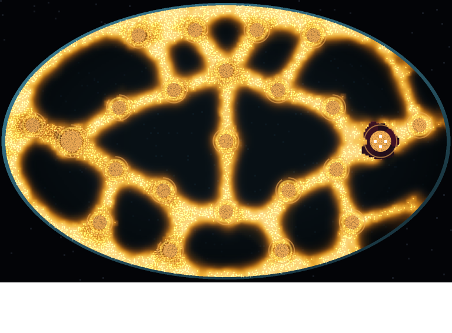
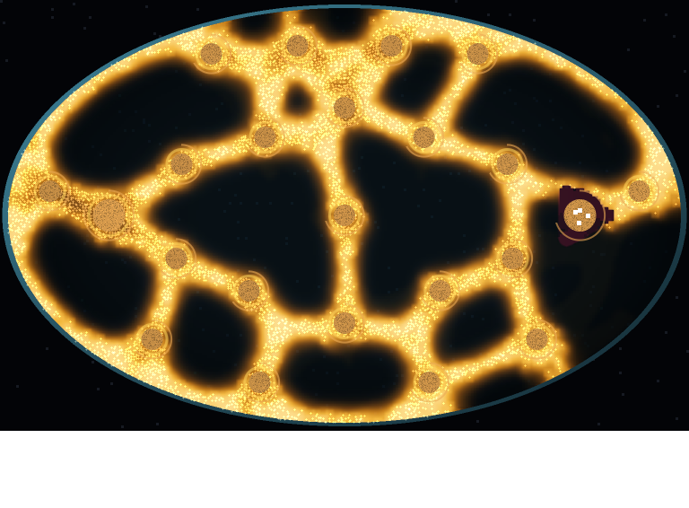
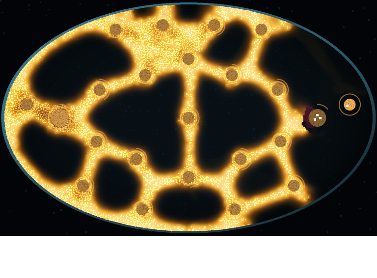
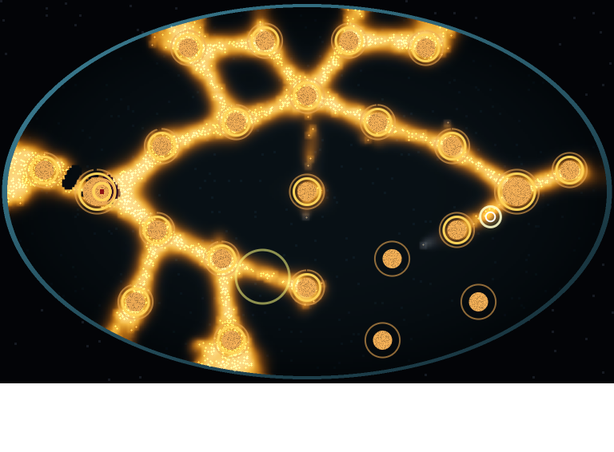

# Larder M1: soldiers and rules in the harness (2026-11-11)

Milestone M1 of the [build plan](larder-build-plan-2026-11-11.md), as revised after three independent reviews. Code: `src/mould/larder.rs` (the game layer), `Dish::fire` (a soldier's shot), `examples/larderm1.rs` (the plans and the census), `src/bin/larder.rs` (M1b, the rough window). Raw output: [census-17-32.txt](larder-m1-2026-11-11/census-17-32.txt), [cost.txt](larder-m1-2026-11-11/cost.txt).

**Result: the gate half passes.** Fortress and farmer beat idle and spend-matched random on 16 of 16 held-out seeds (p 0.00003 each, all survive Holm over 6). Hunter loses to both on 16 of 16: four soldiers walking on the mould die in about 45 game seconds. No run wiped the mould (0 of 80). The squad layer costs 0.098 ms a step with 40 soldiers firing freely (gate: under 0.1) and nothing measurable with 4. Fronts travel 71 s (median) from leaving home to first contact, 10 s or more on 16 of 16.

## What was built

- **Game time:** one game second is 15 dish steps (`larder::GAME_SECOND`); every game rule counts in game seconds through `secs()`. A shot sets its own heal step, so wounds last 4 game seconds (unit test `a_shot_wounds_for_game_seconds`).
- **`Dish::fire(a, b, r, heal)`:** the snip's dab along a segment in one pass over the walkers, with no snip budget, phase check or painted `snip_marks` flash (engineering review, findings 5 and 6).
- **Soldiers:** position, health 100, 10 cells a game second, range 15, a 6-cell line every game second at 10 food. They smell like half a pile, so the mould grows toward them; each walker within 1.5 cells drains 2 health a game second. A dead soldier becomes a 400-food pile (test `a_soldier_in_the_mould_dies_and_becomes_food`).
- **Orders:** hold, move, clear a pile (fire on its eaters, then harvest 30 a game second and carry 300 at a time to the larder), burn a line, attack the core. **Stances:** hold fire, defend (the default: only mould within 4 cells), free fire.
- **The round:** ends when every soldier is dead, when no walker is left, or at the 15-minute cap on share of the piles held. The mould's core is its home pile: a soldier on it with no walker within 10 cells for 5 game seconds takes it and the mould stops dividing.
- **One score** (method review): a win in (1, 3], the cap in [-0.5, 0.5], a loss in [-2, -1), each band ordered by time and soldiers left (test `scores_are_ordered_by_band`).

## The census (seeds 17-32, plans fixed on seeds 1-4)

| Plan | Median score | How rounds ended | Median end | Shots | Food harvested |
| --- | --- | --- | --- | --- | --- |
| Idle | -1.825 | squad wiped 16 | 157 s | 200 | 0 |
| Random (spend-matched) | -1.904 | squad wiped 16 | 86 s | 200 | 0 |
| Fortress | -0.167 | cap 16 | 900 s | 2,799 | 26,700 |
| Farmer | 0.000 | cap 16 | 900 s | 1,136 | 29,400 |
| Hunter | -1.950 | squad wiped 16 | 45 s | 121 | 0 |

   

## What it means for M2

- **Four soldiers cannot attack.** The mould is 2,500 to 6,800 walkers; a squad of four kills a few per shot. Hunter as written marches on the core at 0 s (the only pile being eaten then) and dies. A wipe needs numbers: buying soldiers (M2) is what makes attack possible, so the reader plan's switch is "farm, buy, then hunt".
- **It is still a ladder.** Farmer beats fortress (median 0.000 against -0.167); every fixed plan has one outcome on all 16 seeds. The cap score is coarse: fortress scored exactly -0.167 on 16 of 16 (it holds 1 of 3 held piles). M2 needs the crossover conditions to tell plans apart.
- **The economy has slack.** Farmer harvested 29,400 and spent 11,360 on shots: about 18,000 unspent, which buys soldiers in M2.
- **Kept honest:** hunter's rule was fixed before the held-out run and is reported as it failed, not retuned.
