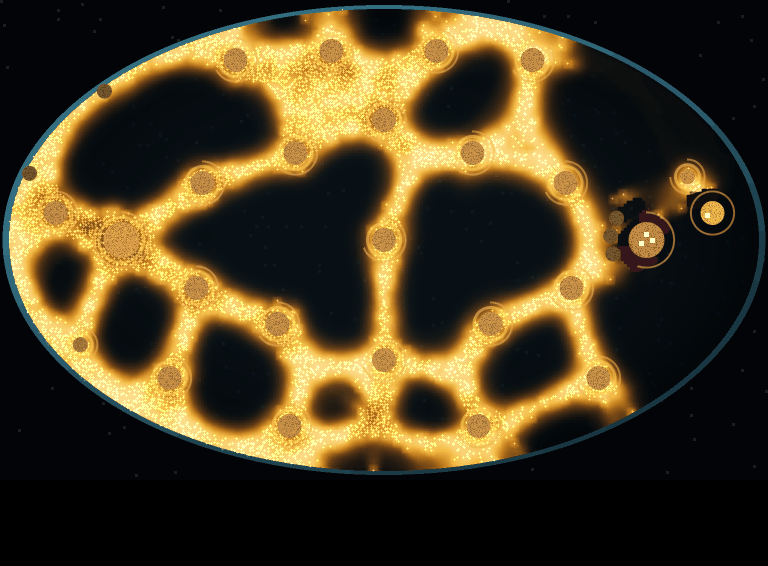
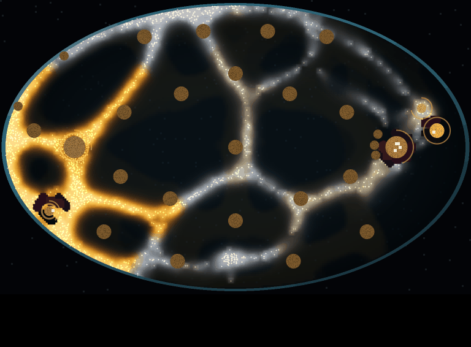

# Larder M2: spending, and the mould's answers (2026-11-11)

Milestone M2 of the [build plan](larder-build-plan-2026-11-11.md), as revised after three independent reviews. Follows [M1](larder-m1-2026-11-11.md). Code: `src/mould/larder.rs` (buy, bait, turrets, hoard smell, hunger, drops), `examples/larderm2.rs` (plans, census, ablations, cost), `src/bin/larder.rs` (B, T and G keys). Raw output in [larder-m2-2026-11-11/](larder-m2-2026-11-11/): the held-out census [census-17-32.txt](larder-m2-2026-11-11/census-17-32.txt), the three ablations (`census-17-32-off-*.txt`), the tuning runs on seeds 1-16 (`tune-1-16-*.txt`) and [cost.txt](larder-m2-2026-11-11/cost.txt).

Page: [Larder M2 Census](https://claude.ai/artifact/1LKdbtQbsQJxv76ApxThRw) (copy: [page.html](larder-m2-2026-11-11/page.html)).

**Result: the gate fails.** On held-out seeds 17-32, no pair of fixed plans changes winner between a fed field and a lean one (gate: 15+ of 16 each way, after Holm). The reader plan beats idle, random, fortress and hunter 16 of 16 in both fields, but not the farmer in a fed field (13 of 16, p 0.021, does not survive Holm over 24) or the baiter in a lean one (12 of 16, p 0.077). The reader is the best plan on 13 of 16 fed seeds and 12 of 16 lean ones. By the plan's own risk table ("a plan best on 13 or more of 16 seeds"), one plan still dominates, and the plan's answer is to give the mould one more answer before building the full window. It is still a ladder: bait the mould away from the larder, farm three piles, and expand once the mould is small.

## What was built

- **Buying soldiers:** 400 food each, at the larder, up to 40 (owner, 03:38Z: "Start with 4 and can grow to 40"). Test `buying_costs_food_and_stops_at_the_cap`.
- **Bait:** spend food to lay a pile of it within a soldier's range on open agar; the mould smells it like any pile. Test `bait_is_a_pile_laid_in_range`.
- **Turrets:** 600 food, 300 health, fire a 6-cell line every game second at the densest mould within 12 cells, each shot paid from the bank; mould touching one drains it like a soldier. Test `a_turret_fires_from_the_bank_and_the_mould_eats_it`.
- **The mould's three answers, on by default:**
  - **Hoard smell:** the larder smells of the bank (strength grows with food held).
  - **Hunger:** a mould eating less than 0.04 food a walker a game second, over a 30 s window, drains soldiers and smells them harder (up to ×2).
  - **Drops:** 1,500 food lands at a random open spot every 60 game seconds, smelling 10 s ahead; none after 10:00 (owner's stalemate ruling, 04:04Z).
- **Window keys:** B buys a soldier, T builds a turret under the cursor, G lays 300 of bait under the cursor; turrets are drawn as grey squares with a health bar. M1b drew its help text in frame pixels where the text call takes logical pixels, so every line landed below the window; fixed here.
- **Rules changed from M1 while looking at seeds 1-4:** drain 2 → 1 and hunger ×3 → ×2 (with both at full, every squad died before 3:00 in both fields), and the "fed" eating rate 0.1 → 0.04 (at 0.1 a fully fed mould read as 0.37 hungry).

## The question and the plans

Does the best plan depend on a state the player can see? Two fields: **fed** (every pile full) and **lean** (every pile but the larder at a quarter). They look alike for two minutes (6,300-7,100 walkers at 2:00 in both) and plainly different by 5:00: the lean mould has gone thin and pale, the fed one is a gold mesh.

Plans (rules in `examples/larderm2.rs`): idle; random, spend-matched; **fortress** (M1's ring plus turrets); **farmer** (one soldier a pile, buys to 8); **hunter** (spends the bank on soldiers, clears the eaten pile nearest the larder); **baiter** (farms three piles; when more than 20 walkers are within 50 cells of the larder, lays 300 of bait toward them); **reader** (plays the baiter until the mould is under 3,000 walkers, from 2:00 on, then farms and buys like the farmer, and hunts once it has 16 soldiers).

**Tuning, seeds 1-16 only.** The reader's first rule read "small" as under 1,500 walkers; no mould was that small at 2:00, so the reader was the baiter in all 32 runs. At 3,000 it switches late in both fields. A second change, buying past one soldier a pile toward 16, was tried and reverted: the fed field did not move (13 of 16 over the farmer either way) and the lean one collapsed (reader median 1.43 → -1.65, squad wiped 16 of 16), because extra soldiers walk into a starving mould and feed it. Plans were then frozen.

## The census (seeds 17-32, held out)

| Plan | Fed median | Fed ends | Lean median | Lean ends |
| --- | --- | --- | --- | --- |
| Idle | -1.812 | squad wiped 16 | -1.816 | squad wiped 16 |
| Random (spend-matched) | -1.913 | squad wiped 16 | -1.914 | squad wiped 16 |
| Fortress | -1.835 | squad wiped 16 | -1.845 | squad wiped 16 |
| Farmer | -1.419 | cap 4, wiped 12 | -1.665 | mould wiped 1, cap 3, squad wiped 12 |
| Hunter | -1.950 | squad wiped 16 (45 s) | -1.951 | squad wiped 16 (45 s) |
| Baiter | -0.333 | cap 16 | 0.167 | mould wiped 5, cap 9, squad wiped 2 |
| Reader | -0.300 | cap 16 | 1.459 | mould wiped 11, cap 5 |

Paired comparisons (sign test, Holm over 24): the baiter beats the farmer 13 of 16 in both fields, so nothing crosses over. Reader against farmer, fed: 13 of 16 (p 0.021, -). Reader against baiter, lean: 12 of 16 (p 0.077, -). Every other reader comparison is 16 of 16 or (reader against baiter, fed) 8 of 8 with 8 ties, all surviving Holm.

Pictures, seed 17 (in [look/](larder-m2-2026-11-11/look/)): the reader at 2:00, 5:00, 10:00 and the end in each field; the baiter in the lean field at 5:00 and the end; the farmer's end in each.

 

Seed 17 shows the reader's flaw plainly: in the lean field it reaches the cap with 10 walkers left alive (score 0.33), where the baiter wiped the mould at 10:00 (score 1.43). The reader never reaches 16 soldiers, so it never hunts the remnant.

## Each answer switched off (seeds 17-32)

| Switched off | Reader fed | Reader lean | Baiter fed | Baiter lean | What changed |
| --- | --- | --- | --- | --- | --- |
| Nothing | -0.300 | 1.459 | -0.333 | 0.167 | |
| Hoard smell | 0.167 | 1.411 | -0.167 | 0.167 | Fed reader now beats the farmer 16 of 16: the smell of the bank is what makes saving cost |
| Hunger | -0.300 | 1.434 | -0.333 | 0.500 | No change in fed (mean hunger 0.001); in lean, baiter beats farmer 14 of 16 |
| Drops | -0.333 | 1.565 | -0.333 | 1.470 | The lean mould starves to death on 16 of 16 for both plans: drops are what keep a lean mould alive |

Hoard smell and drops each change outcomes; hunger barely does, because a mould that has been eating is never hungry long enough for it to act.

**Cost:** the game layer with all three answers on, 40 soldiers firing freely and 3 turrets, measures 0.053 ms a step over a bare dish step (0.884 against 0.831 ms); with 4 soldiers it reads below zero, within noise (the squad's kills shrink the mould). Under M1's 0.1 ms gate.

## What next

- **One more answer for the mould** (the plan's rule when one plan dominates). The lean field shows why: waiting always wins there, because a lean mould starves on its own once the drops stop. An answer that makes waiting lose against a lean mould, and attacking pay, would give the crossover the gate asks for. The candidate: a starving mould sends out spores that start new colonies at far piles (visible as it happens). A fed mould is too big to attack, so baiting wins there; a lean mould would have to be killed before it spores.
- **The reader** should hunt a remnant it can beat, not wait for 16 soldiers.
- **Hunger** needs a lower bar or a shorter window to matter, or should go.
- **Kept honest:** the reader's rule was fixed on seeds 1-16 before the held-out run and is reported as it failed.
