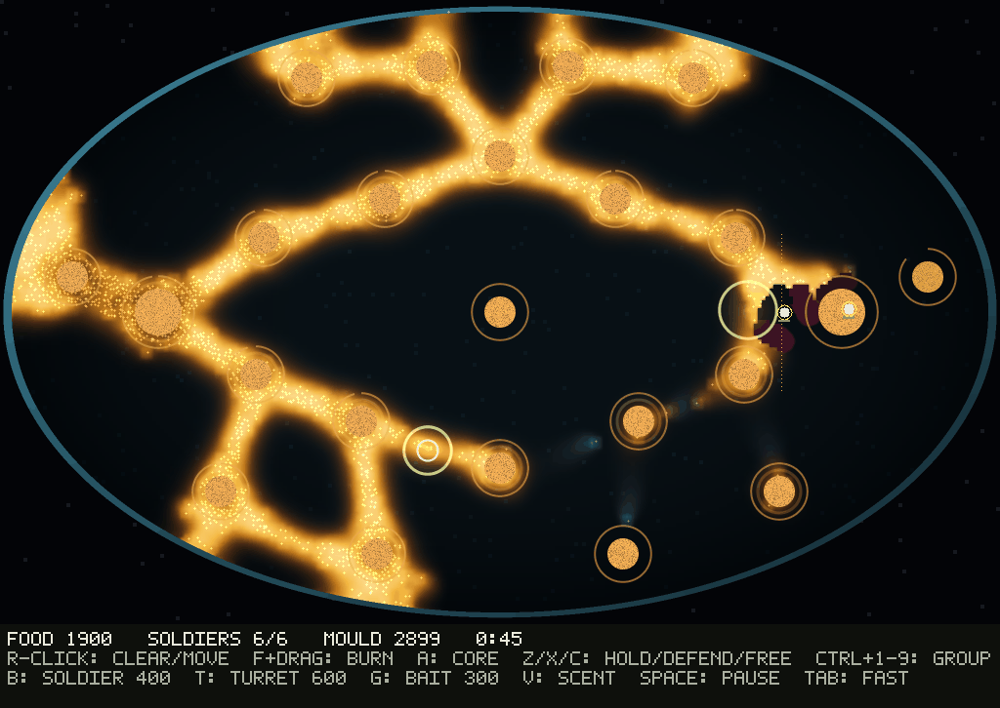
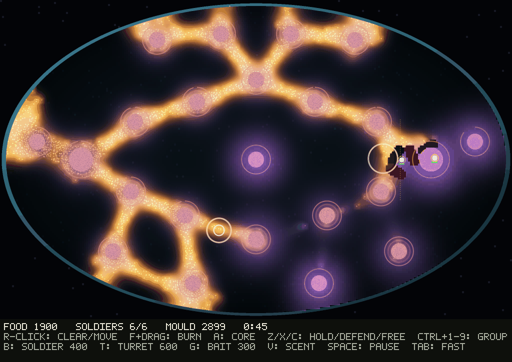

# Larder M3: full controls, and soldiers that fight from range (2026-11-11)

Milestone M3 of the [build plan](larder-build-plan-2026-11-11.md), after [M2](larder-m2-2026-11-11.md), whose gate failed because one plan dominated. Built overnight on the owner's word ("keep building autonomously"); the owner was asked on a card whether to keep tuning M2 or move on to M3, and this went ahead on the recommended option while waiting. Code: `src/mould/larder.rs` (soldier fixes, `Cmd` and replay), `src/bin/larder.rs` (the window), `examples/larderm2.rs` (the striker plan). Raw output in [larder-m3-2026-11-11/](larder-m3-2026-11-11/).

Page: [Larder M3 Window](https://claude.ai/artifact/CXSwsJbdxKyi2G5TnZhxZ4) (copy: [page.html](larder-m3-2026-11-11/page.html)).

**Result.** The soldier fixes alone loosened the ladder. On held-out seeds 17-32 no plan is best on 13 or more of 16 any more: the reader is best on 8 fed and 10 lean seeds (M2: 13 and 12), the timed striker on 5 and 4, the farmer on 3 and 2. Two pairs now change winner between the fields (striker against farmer, striker against baiter), but neither is significant, so the M2 gate as written still fails. The window's frame on Scott-Desktop is 7.2 ms mean, 9.6 ms p95 with 40 soldiers (gate: under 10 ms), and 8.9 ms mean, 11.6 ms p95 with the scent view on. Of that, 6.1 ms is the shared dish renderer and 0.93 ms the game step. The owner's playtest is the other half of the gate, still to come.

## What was built

- **Soldiers fight from range.** A soldier told to clear a pile the mould is eating now stops at range (13 cells) and fires, and walks in only once the pile is clear. In M1 and M2 it walked straight onto the pile. In the first look at a timed attack, 18 soldiers died in 47 s against a 446-walker mould, and each body became a 400-food pile for it.
- **Shots spread.** The walker bins are counted once a step. A shot now empties its bin, so the next soldier aims somewhere else instead of at walkers already dead.
- **Loose formation.** Soldiers sent to one point spread on a spiral 1.5 cells apart instead of stacking on one cell. A first version broke harvesting: the fortress's farmer, 2.6 cells off the larder, never counted as "at" it. That was found while looking and fixed before any census.
- **Control groups.** Ctrl+1-9 stores the selection; 1-9 recalls it. Stances moved to Z, X and C.
- **Scent view (V).** The dish's own scent field, the smell the mould climbs, drawn as a violet wash. It is a view of the data, not an effect.
- **Replays.** Every command goes through `Game::apply`, which logs it with its step. R and Esc save the log to `larder-replay-SEED.txt`. `larder replay FILE` plays it back with no window. The test `same_commands_same_hash` checks that a replayed log reaches the same dish hash.
- **`larder shot REPLAY OUT.png [scent]`** saves the window's exact frame with no display. The pictures here were made that way.
- **`larder bench`** times a frame's work (one step and a full draw) with 40 soldiers on free fire, with the scent view off and on.
- **HUD fix** (M2): the help text is now inside the window.
- **Striker plan** (`larderm2`): bait and farm until 6:00, then buy and hunt. By 6:00 a lean mould has crashed to a few hundred walkers (seed 1: 6,591 at 2:00, 446 at 6:00) and a fed one has not (6,563).

## Census, seeds 17-32 (held out; nothing was tuned on them)

| Plan | Fed median | Fed best on | Lean median | Lean best on |
| --- | --- | --- | --- | --- |
| Farmer | -0.375 (cap 12, squad wiped 4) | 3 | 1.375 (mould wiped 13) | 2 |
| Baiter | -0.500 (cap 16) | 0 | 0.000 (wiped 6, cap 10) | 0 |
| Striker | -0.500 (cap 15) | 5 | -1.450 (wiped 4, squad wiped 12) | 4 |
| Reader | -0.250 (cap 16) | 8 | 1.586 (mould wiped 16) | 10 |
| Idle / random / fortress / hunter | -1.79 / -1.91 / -1.83 / -1.93 | 0 | -1.79 / -1.91 / -1.84 / -1.93 | 0 |

M2's numbers, same seeds, for comparison: reader -0.300 fed and 1.459 lean, best on 13 and 12; farmer -1.419 and -1.665.

Pairs that flip between fields (sign test, Holm over 34; none survives):
- Striker beats the farmer fed (10 of 16); the farmer beats the striker lean (12 of 16).
- Striker beats the baiter fed (7 of 11); the baiter beats the striker lean (12 of 16).

The reader beats idle, random, fortress and hunter 16 of 16 in both fields, and the baiter 9 of 9 fed and 16 of 16 lean. It does not clear the farmer (11 and 13 of 16) or the striker (7 of 12 and 12 of 16).

The same comparison on seeds 1-16 ([census-1-16.txt](larder-m3-2026-11-11/census-1-16.txt)) agrees: the best plan is split 9/4/3 between reader, farmer and striker in each field.

**Cost:** the game layer is 0.030 ms a step over a bare dish step at 40 soldiers and 3 turrets ([cost.txt](larder-m3-2026-11-11/cost.txt)). Desktop frame runs: [desktop-bench.txt](larder-m3-2026-11-11/desktop-bench.txt).

Both frames come from the replay [clear.txt](larder-m3-2026-11-11/pics/clear.txt) at 0:45 (dish hash e0056e66a9b13baa): four soldiers clearing the pile beside the larder, two more bought and set to burn a line. The scent view shows the smell of the untouched piles, which are free and full, and none where the mould has eaten.

## Two mould answers, rejected

Both were tried as M2's "one more answer" and removed. The dead-ends entries record what would make them worth another look.
- **Spores**, seeds 1-4: a hungry mould sends 15% of its walkers to the farthest uneaten pile. It sent 9-14 spores a round and the lean mould still died once drops stopped, because no new food comes with a spore.
- **Crust**, seeds 1-16: a starving mould goes dormant away from food and wakes near it. Lean wins became stalemates: reader mould wipes went from 13 to 2 of 16, and every working plan's median was 0.000. The timed striker still died.

## What next

- **The owner's playtest** of the window (`cargo run --release --bin larder -- 17`). This is the other half of the M3 gate, and it shows whether a person finds the counters the scripts don't.
- **Frame:** the scent view's 2 ms (a log and a blend per cell) can be cached per game step if the owner plays with it on. The dish draw is the shared renderer, not Larder's.
- **M4 upgrades**, then the M2 gate re-run, as the plan has it.
