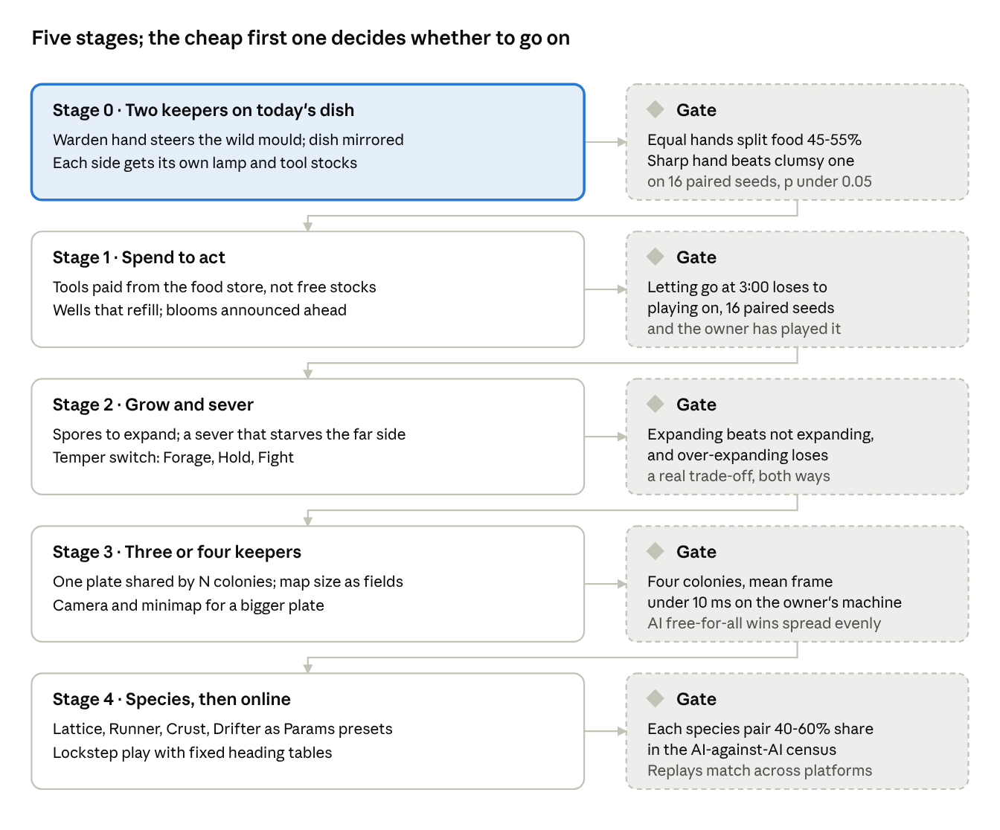

# Slime mould RTS: design review (2026-11-10)

**Status: design and evaluation only, nothing built.** Asked by the owner on
2026-11-10: review how this simulation could become a real-time strategy
game, with an original design. This is the repo copy of the Claude Doc
shown in the project thread
(https://claude.ai/artifact/EDygsdTpEg8vK7HZzTXhdp); the roadmap drawing is
[`rts-design-2026-11-10/roadmap.png`](rts-design-2026-11-10/roadmap.png).
Read against `main` at `b8efc14`.

## Summary

Yes, the simulation can carry a real-time strategy game, and about half of an
RTS is already in the code. The Wild One already runs two moulds that share
food, hold borders and fight where they touch; a tube is a supply line, a pile
is a resource node, and the food store is both bank and population. What is
missing is the strategy layer: an opponent who also has hands, a reason to
spend instead of just act, and decisions that still matter after the first 30
seconds.

The recommended shape is an **indirect-control RTS**. You never select a
walker or give it an order. You are the keeper above the plate, and your army
is a mould you can only lure, push, wall off, cut and water, against a rival
keeper doing the same to theirs. Working title: **Bloomfront**.

The biggest risk is not technical. Review 2 found The Wild One is decided by
an opening salt wall and then by aim within about 2 cells; an RTS lives on
mid-game choices, so every stage below is judged first by whether letting go
of the controls partway through loses to playing on.

The cheapest real test is small: let a scripted hand steer the wild mould in
The Wild One, mirror the dish, and see whether two equal keepers split the
food near 50/50 while a better hand beats a worse one on paired seeds.

**Since this draft (2026-11-10, later).** Six brainstorm agents went further,
including two that set the demo's tools aside. Their directions (a contagion
war over a neutral mould, timed food waves, road tension, pattern counters, a
card layer) and their notes are in
[`rts-design-2026-11-10/brainstorm/`](rts-design-2026-11-10/brainstorm/README.md).
One finding corrects this draft: the food store is never a bank (see the
correction under *The game: Bloomfront*).

**Red team (2026-11-10, later).** A fresh agent attacked this draft and the
brainstorm's directions, with probes on today's dish:
[`rts-design-2026-11-10/red-team/`](rts-design-2026-11-10/red-team/README.md).
For Bloomfront it found that Stage 0's gates would pass without testing the
opening: equal scripts on a mirrored dish split near 50/50 by symmetry, and a
sharp hand beating a clumsy one only confirms the aim test. It recommends a
paired-clone verb census before Stage 0 (see the note under *Recommended
path*).

**Field retest and verb census (2026-11-10, later).** After the owner said 7
piles limit the options, the red team's findings were rerun on 23 smaller
mirrored piles, and the census was run on both dishes:
[`rts-design-2026-11-10/field/`](rts-design-2026-11-10/field/README.md).
Taut's pull wins share there, the pattern counters cycle on one layout of
two, and a salt line across the rival's road is the one verb that passes on
share; on The Wild One only the lamp moves share.

## What the simulation is today

The game is a Jones-style walker model on one bounded 256 x 160 dish
(`src/mould/mod.rs`), stepped twice a frame at 60 frames a second, with no
engine underneath. A few hundred to a few thousand walkers sense a trail three
points ahead, turn toward the strongest, step and lay trail; the trail spreads
and fades, and tubes, loops and dead ends emerge from that.

What the game adds to Jones is what makes an RTS plausible:

| Game rule in the code | Where | What it already means in RTS terms |
| --- | --- | --- |
| One food store pays for every new walker and every walker's upkeep | `Dish::store`, `Params::upkeep`, `Params::eat` | Bank and population are the same number |
| Food only reaches walkers through tube within `feed_reach` cells of food | `Dish::fed`, the census every 6 steps | Supply lines: a cut tube starves what is beyond it, gradually |
| A pile feeds at most `table` walkers, shared by head count between moulds | `Pile::bite`, `Pile::foe_eaters` | Contested resource nodes: crowd a pile to steal it |
| Each mould's trail repels the other | `Params::foe_repel` | Borders form on their own |
| A walker beside foes dies with chance `fight x neighbours / 8`, halved on fed tube, doubled off it | `Dish::fight_losses` | A supplied front holds; a stray loses |
| Lamp pushes trail and walkers, oats lure and pay, salt walls, knife cuts, water wakes sleepers | `push_light`, `place_oats`, `begin_stroke`, `place_water` | The command layer, all indirect |
| Scripted hands play any dish through one `Player::act(&mut Dish)` call | `src/mould/play.rs`, `examples/mouldprobe.rs` | An AI interface, and a census harness to tune it |
| Seeded rng per mould, single-threaded step | `Rng`, `Dish::step` | Replays and lockstep are possible on one platform |

The second mould (`Dish::rival`) is a whole second `Dish` with its tools
zeroed, stepped in turn with yours, and the two share the piles by copying
them back and forth each step. It costs about +1.4 ms a frame (mean 4.3-4.9 ms
to 5.7-6.3 ms at scale 4, `Reports/mould-wild-one-2026-11-10.md`), so a
two-mould frame uses about a third of the 16.7 ms budget.

What the measurements say about play matters as much as the code. In The Wild
One the tool hand beats doing nothing and random 8-0 on food share, but
letting go at 0:30 scores about what clumsy play to the bell does, two stars
need aim within about 2 cells, and the knife changes nothing because a cut
heals. Keep It Alive's lives fall into two humps largely by luck
(`Reports/mould-review-2-2026-11-10.md`).

Measured in this session on `main` (`b8efc14`), The Wild One, 4 seeds, 150 s
each (`mouldprobe level=5 players=idle,warden seeds=1,2,3,4`): each side ends
with 350-1,000 walkers, about 2,600 walkers a side die fighting when nobody
plays, and a whole two-mould game steps headless in 18.5-20.7 s, about 1.1 ms
per step for both moulds. The window's frame with the warden playing averaged
7.42 ms (worst 20.09 ms) on this cloud machine, which runs slower than the
5.7-6.3 ms the report measured. Raw lines:

```
seed 1      idle: 0 stars  ... mould 348  ... wild 550 fought 2954/2674 ate 69634/71106 share 0.495  (18.5 s)
seed 2      idle: 0 stars  ... mould 420  ... wild 444 fought 2663/2664 ate 68449/70036 share 0.494  (18.7 s)
seed 3      idle: 0 stars  ... mould 388  ... wild 490 fought 2648/2611 ate 69051/70437 share 0.495  (19.3 s)
seed 4      idle: 0 stars  ... mould 436  ... wild 411 fought 2622/2573 ate 69485/70398 share 0.497  (18.6 s)
seed 1    warden: 2 stars  ... mould 679  ... wild 225 fought 1699/1830 ate 93886/51786 share 0.645  (20.7 s)
seed 2    warden: 2 stars  ... mould 948  ... wild 265 fought 1295/1641 ate 95222/50645 share 0.653  (20.6 s)
seed 3    warden: 2 stars  ... mould 717  ... wild 209 fought 1758/1972 ate 97487/48939 share 0.666  (20.2 s)
seed 4    warden: 3 stars  ... mould 992  ... wild 5 fought 1343/1397 ate 94303/49656 share 0.655  (20.2 s)
frame cost, dish 5 intended hand: 9000 frames, mean 7.42 ms, worst 20.09 ms
```

## The game: Bloomfront

Bloomfront is a 5 to 10 minute match on one shared plate between two to four
keepers, each with a mould of their own colour on a home pile. You command an
army that has no units: your mould's mass is where you fight well, and its
tubes are where your food runs. You win by reshaping the network, never by
clicking a soldier.

**The one rule that makes it strategy:** every action is paid out of the same
food store that grows your mould. An oat, a lamp burn, a salt wall or a spore
launch is food you did not turn into walkers. Today the tools have fixed
stocks that regrow on a timer, so using them is always free; in Bloomfront
spending is the decision.

**Correction (2026-11-10, later):** the store holds almost nothing to spend.
A trace of The Wild One every 10 s found `Dish::store` at a median of 0 and a
maximum of 108, against 1,500 at the start, because each piece turns any
surplus into walkers at once (`Params::pieces`;
[`storetrace.txt`](rts-design-2026-11-10/brainstorm/storetrace.txt)). So the
spending rule needs its own currency first, such as a capped reserve or
paying with the mould nearest the click. It is not the small change the
mechanics table below says.

### Player verbs

| Verb | Tool | RTS role | What it costs |
| --- | --- | --- | --- |
| Lure | Oats | Rally point: pull a front toward a place | Food from the store, per pile |
| Push | Lamp | Herd any mould, yours or theirs, and dry the ground | Food per second held |
| Wall | Salt | Fortify a border or a chokepoint | Food per cell laid |
| Sever | Knife | Raid a supply line so the far side starves | A charge that refills slowly |
| Wake | Water | Bring a sleeping reserve back into the fight | A charge that refills slowly |
| Fruit (new) | Spores | Expand: launch spores that start a new colony where they land | A large share of the store, and the walkers that fruit |
| Temper (new) | Mould mood | Set your mould to Forage, Hold or Fight for a while | A cooldown, no food |

### The map

The plate holds **wells**, piles that refill slowly and never quite run dry,
instead of only the finite piles the dishes use now. Home wells sit near each
start, contested wells sit between keepers, and **blooms** of rich food land
at announced places with a visible countdown. Announcing them matters: late
food landing on the seam was tried in The Wild One and rejected because it
rewarded whoever was nearer by luck, and its recorded re-test condition is a
preview the player can prepare for (`Reports/dead-ends.md`).

### Winning

- **Feast** (default): the largest share of all food eaten by the bell, the
  score The Wild One already uses (`Dish::food_share`), because a running
  total cannot be swung by the last ten seconds.
- **Smother**: the rival has no walkers left, The Wild One's third star today.
- **Hold**: a majority of the wells fed by your tube for 60 seconds straight.

### What you see

Owner's rule: everything on screen is the simulation. Bloomfront keeps it.
Ownership is colour per mould (gold against violet already), supply shows as
the hunger blend the simulation look already draws, and a cut front visibly
greys and thins as it starves. Fog of war is the one candidate that could
break the rule; it only fits if what you see is a held quantity, for example
the cells your walkers' sensors reach, drawn through one fixed ramp. That is a
question for the owner, below.

## Mechanics and how far the code already goes

Most of the RTS's mechanics are re-uses of rules that already run; the hard
part is the two-mould plumbing, not the ideas. Sorted from cheapest to most
expensive.

| Mechanic | Already in the code | What is new | Main code touched | Cost |
| --- | --- | --- | --- | --- |
| Contested resources | Shared table per pile, split by head count; food share scored | Wells that refill; announced blooms | `Pile`, `level.rs` | Small |
| Territory and borders | Each trail repels the other; walkers never share a cell | A territory count (tube cells per mould) for the HUD and the Hold win | `Dish::measure` | Small |
| Combat at the front | Fight chance by foe neighbours, halved on fed tube, doubled off it | Fight odds as `Params` per species instead of the fixed 0.5 and 2.0 | `fight_losses` | Small |
| Spending from the store | One store pays growth and upkeep; tools have regrowing stocks | Each tool draws from the store instead of a stock | `place_oats`, `begin_stroke`, `set_lamp` | Small |
| Supply raids | Food reaches walkers only along tube; per-piece stores (`Params::pieces`) | A sever that stays open long enough to starve the far side; today's wound heals in 4 s, which is why the knife moved nothing in The Wild One | `Ground::Wound`, `Params::wound` | Small, but needs tuning against the census |
| Temperament | Sensor angle 22.5 vs 45 degrees is measured: 22.5 branches and joins everything, 45 obeys oats and then freezes; `settle_seconds` eases between them | A player switch between Forage, Hold and Fight presets with a cooldown | `Params`, the HUD | Small |
| A rival keeper with hands | The `Player` trait; the warden hand wins 16 of 16; `HJIT` and `HLAG` already make a hand clumsier or slower | A player acting on the rival `Dish`; per-side tool stocks; two lamps lighting one shared light field (today `r.lamp = self.lamp` copies one lamp) | `Dish::step`, `update_light`, `play.rs` | Medium |
| Expansion by spores | Inoculating a blob anywhere (`inoculate`); a fruiting and spore design already written (`complexity.md`, R6) | Spend store and walkers to fruit; spores travel and sprout only on damp agar | `mod.rs`, the wet field | Medium |
| Three or four colonies | Two, as a cloned `Dish` whose piles are copied back each step | One plate owning ground, piles, light, wet and scent, with N colonies owning trail, walkers, store and params | `Dish` split into plate and colonies | Large |
| A bigger map with a camera | One 256 x 160 dish; the lamp already steps only its own light box | Stepping only the cells near any mould, or splitting the spread across threads | `spread`, `step_own` | Large |

### Species

Each mould is already its own `Dish` with its own `Params`, and The Wild One
already gives the wild mould a different repel (0.6 against 1.0). A species is
a preset of those numbers plus one signature rule, so asymmetric factions cost
tuning time rather than new systems.

| Species | Plays like | Built from |
| --- | --- | --- |
| Lattice | Balanced; obeys lures, holds a front | Today's defaults: 45 degrees, reach 9 |
| Runner | Grabs the map early, loses straight fights | 22.5 degrees, higher divide, weaker fight odds |
| Crust | Turtles: thick walls, sleeps through famine, wins on its own tube | Higher `wall_grow` and `crust_life`, stronger fed-tube fight bonus |
| Drifter | Few walkers, cheap spores, hard to pin down | Low divide, spores at half price |

The sibling thread on Sage Jenson's work is looking at contagion. If contact
can convert a foe's walker rather than kill it, that is a fifth species'
signature rule and a natural fit for the existing fight step; this design
leaves a slot for it rather than guessing the mechanism.

## Technical feasibility

A two-keeper match on today's dish size fits comfortably; four keepers on
today's dish probably fit; a map several times bigger does not fit without new
work. The figures below scale this session's measurement (about 1.1 ms per
step for two moulds, two steps a frame) and are estimates until measured.

| Setup | Sim per frame (estimate) | Fits a 16.7 ms frame? | What it needs |
| --- | --- | --- | --- |
| 2 colonies, 256 x 160 (The Wild One today) | about 2.2 ms measured; 7.4 ms with drawing here | Yes | Nothing |
| 4 colonies, 256 x 160 | about 4.4 ms | Probably; worst frames already reach 20 ms | The plate-and-colonies split |
| 2 colonies, 512 x 320 | about 9 ms | No, once drawing and worst frames are added | Step only near the moulds, or spread rows across threads, or one step a frame |

**Map size is a compile-time constant.** `W` and `H` are `pub const` in
`mod.rs` and every index goes through them, so maps of different sizes mean
turning them into fields. That is mechanical but touches most of the module.

**Determinism.** Each mould has its own seeded rng and the step is
single-threaded, and review 2 reproduced every figure in both dish reports,
which is good evidence that a given seed replays the same on one machine.
Across platforms it is not guaranteed: `mod.rs` calls float `sin`, `cos`,
`sqrt` and similar 14 times, and those can differ between platforms. Replays
and same-platform lockstep are safe now; cross-platform lockstep would need
lookup tables for headings or a fixed-point heading. Threading the spread would
also have to keep a fixed order.

**Multiplayer fits the genre unusually well.** One colony's fields are several
164 KB float planes, far too much to send every frame, but the inputs are
tiny: a tool, a point, a frame number. That points to deterministic lockstep.
The mould answers a lure over seconds, so a 100-200 ms input delay should be
invisible, where it hurts in a click-to-move RTS. Recommend single-player
against AI first and online play last.

**AI opponents are the best-supported part.** A keeper AI is a `Player` whose
`act` drives the rival colony instead of yours. The warden already wins 16 of
16, and `HJIT` (aim error) and `HLAG` (seconds between looks) already turn it
into weaker hands, which is a difficulty slider for free. `mouldprobe` can
then run AI against AI over paired seeds, which doubles as the balance test
for every species and map.

**Input and interface.** Every verb is a click, a hold or a drag on the plate,
the same as now, so the tool bar and keys carry over. New on screen: each
verb's food cost, the bloom countdown, and on a bigger map a camera and a
minimap, which can be the simulation drawn small. None of that sits on the
plate, so it does not touch the owner's rule.

## Risks and open questions

The design risks outweigh the technical ones. In order of how likely each is
to sink the idea:

1. **The game is decided in the opening.** In The Wild One a salt wall at the
   start earns the first star and letting go at 0:30 keeps it on 8 of 8 seeds.
   An RTS needs a mid-game. Bloomfront's answers are spending from the store,
   refilling wells, announced blooms and spores, and each is untested.
2. **Luck, not skill, decides matches.** Keep It Alive flips between a short
   and a long game on the same seed. A competitive mode needs mirror matches
   between equal hands to land near 50/50 with a narrow spread, or nobody will
   feel they lost fairly.
3. **Indirect control frustrates.** At 45 degrees the mould obeys every oat
   and then freezes; at 22.5 the lamp's effect is lost in the mould's own
   rewiring. If the middle ground is not found, the game reads either as a
   puzzle or as watching.
4. **Cuts do not bite.** Supply raids are an RTS staple, and today a cut heals
   before anything beyond it starves. Making a sever stick is handoff step 3
   already; Bloomfront depends on it.
5. **Cost on a big map.** Covered above; it decides how big a four-keeper map
   can be.

Questions for the owner:

- Is a fog of war allowed if it is drawn from a held quantity, such as where
  your sensors reach? Without it, scouting and surprise mostly vanish.
- Should Bloomfront wait for the work already queued (Keep It Alive's luck,
  The Wild One's mid-game, the forest floor), or replace The Wild One's next
  steps? The first stage below does both at once.
- Two keepers only, or is three-or-four free-for-all wanted? Four is the one
  item that needs the large plate-and-colonies split.

## Recommended path

Build Stage 0 first: it is a small change to The Wild One, it answers the
mid-game question review 2 left open, and it fails cheaply if the idea is
wrong. Each later stage starts only once the gate before it passes, judged the
repo's way: scripted hands on paired seeds against idle and random controls,
sign tests, and the owner's own play overruling the table.



| Stage | Builds | Gate |
| --- | --- | --- |
| 0 · Two keepers on today's dish | Warden hand steers the wild mould; dish mirrored; each side its own lamp and tool stocks | Equal hands split food 45-55%; a sharp hand beats a clumsy one on 16 paired seeds, p under 0.05 |
| 1 · Spend to act | Tools paid from the food store, not free stocks; wells that refill; blooms announced ahead | Letting go at 3:00 loses to playing on, 16 paired seeds, and the owner has played it |
| 2 · Grow and sever | Spores to expand; a sever that starves the far side; Temper switch (Forage, Hold, Fight) | Expanding beats not expanding, and over-expanding loses: a real trade-off, both ways |
| 3 · Three or four keepers | One plate shared by N colonies; map size as fields; camera and minimap | Four colonies, mean frame under 10 ms on the owner's machine; AI free-for-all wins spread evenly |
| 4 · Species, then online | Lattice, Runner, Crust, Drifter as Params presets; lockstep with fixed heading tables | Each species pair 40-60% share in the AI-against-AI census; replays match across platforms |

Stage 0 in detail, since it is the decision in front of the owner:

1. Give the wild mould a `Player` (the warden hand) and its own tool stocks,
   and let two lamps light one shared light field.
2. Mirror The Wild One so both homes sit the same distance from the same
   piles.
3. Census in `mouldprobe`: warden against warden, warden against a clumsy
   warden (`HJIT=6 HLAG=2`), and warden against idle, 16 seeds each, scored on
   food share. Quote the frame cost.
4. Put the pictures and counts on a page for the owner to play against.

If equal hands do not split near 50/50, the dish layout or the rng order
favours a side and must be fixed before any RTS layer is worth building. If a
sharp hand cannot beat a clumsy one, the mould does not reward skill against a
thinking opponent, and Bloomfront should stop there.

**Note (2026-11-10, later, after the red team).** Stage 0 is no longer the
recommended first step. Its two gates would pass without testing Bloomfront's
top risk, and running it first would re-anchor the plan on the demo's tools,
against the owner's 18:15 ruling. The red team's first test is cheaper and
can kill a direction outright: clone The Wild One at 60 s, apply one verb in
one copy, and compare food share over 30 s on 16 seeds
([red team, §9](rts-design-2026-11-10/red-team/README.md)). Stage 0's
two-keeper plumbing stays useful as a harness for any direction that keeps two
moulds.
