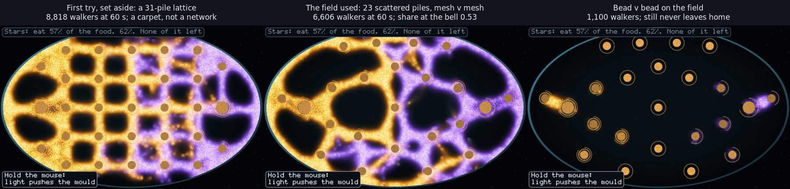
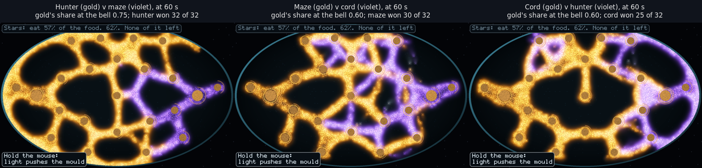
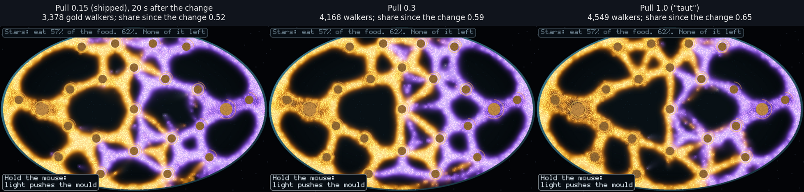

# The field retest and the verb census (2026-11-10, design only)

The owner, 19:24Z, on the red team's dish: "Your test environment seems small
with only 7 food sources. That probably limits the potential options." This
report reruns the red team's layout-sensitive findings on a richer dish, then
runs the verb census the red team named as the next step. No game rule or
default changed; everything here is in the
[red-team harness](../red-team/harness/src/main.rs).

**In short.** On a dish with 23 smaller piles the moulds grow to about 6,600
walkers, about Jones's density, and two of the red team's verdicts turn over.
The pattern counters form a cycle (hunter > maze > cord > hunter, all three
links surviving Holm), but only on one of the two pile layouts tried. Taut's
pull, which collapsed the mould on The Wild One, wins food share on the field
on every seed. The verb census finds that which verbs work depends on the
dish: on The Wild One only the lamp moves share, and not by 0.02 on enough
seeds; on the field a salt line across the rival's supply road moves it on
14 of 16 seeds and beats a randomly placed line. With no hands at all, the
side ahead at 60 s keeps the lead in about 4 games of 5.

## The field

The Wild One's grid, homes and 400-walker inocula, with its 7 piles swapped
for 23 smaller ones, mirrored left to right so neither side has the better
map (`field_dish` in the harness).

- **scatter** (the main layout): 9 mirrored pairs from a Poisson-disc draw,
  3 piles on the centre line and the two homes; 375k food against The Wild
  One's 260k.
- **scatter2**: a second draw (seed 11) with the same counts, to see what
  depends on the layout.
- **lattice** (set aside): 31 piles on a grid grew 8,818 walkers by 60 s and
  covered the dish in a carpet, not a network.

At 60 s two mesh moulds on scatter hold 6,553-6,661 walkers between them,
3.3x The Wild One, which is about 16% of the 41,000 cells against Jones's 15%
and The Wild One's 5%. Bead (112.5 degrees) still grows only about 1,100 and
never leaves home, so it is left out of the grid.

## Deciding measures, named before the runs

- **Grid:** a link a > b holds when a takes more than half the food in a
  sign-test majority of 32 games (16 seeds, sides swapped) and survives Holm
  over the 10 pairings on that layout. A cycle is three links that hold and
  close.
- **Opening:** how often the side ahead at 30 s and at 60 s still leads at the
  bell (150 s), with no hands.
- **Taut:** the red team's test unchanged (clone at 60 s, set one mould's
  `Params::fed_scent`), now scored by share since the change at +30 s.
- **Verb census:** the red team's bar. Food share since the action, at +30 s,
  moves 0.02 the intended way on 13 of 16 seeds, with a visible change near
  the action by 5 s on all 16. Added from the method: the planned use must
  beat a random use, paired by seed. Holm over the 12 plan-v-control tests.

## The pattern grid

Five settings (hunter, mesh, runner, cord, maze), every pairing both ways
plus mirrors, 16 seeds: 444 games on scatter, 400 on scatter2.

| Pairing | scatter: first named won | scatter2 |
|---|---|---|
| hunter v maze | 32/32 | 28/32 |
| maze v cord | **30/32** | **11/32** (p 0.11, does not hold) |
| cord v hunter | 25/32 | 30/32 |
| hunter v mesh | 31/32 | 30/32 |
| cord v mesh | 28/32 | 30/32 (1 tie) |
| maze v mesh | 28/32 | 30/32 |
| hunter, mesh, cord, maze v runner | 32/32 each | 32/32 each |

- **scatter:** every link holds under Holm (the weakest, cord > hunter, p
  0.0021 against a bar of 0.05), so **hunter > maze > cord > hunter is a
  cycle.**
- **scatter2:** nine links hold; cord v maze goes 21/32 to cord, p 0.11, so
  **no cycle.** The maze–cord link depends on where the piles fall.
- On both, runner, third on The Wild One, now loses every game to every
  other setting, and mesh, the shipped default, beats only runner. The Wild
  One's straight ladder was a fact about 7 piles.

Every mirror fights on both layouts (16 of 16 a setting), where on The Wild
One cord and bead never touched. Equal settings still split widely by seed:
the self side's share runs 0.226-0.731 for maze, 0.485-0.725 for cord,
0.439-0.554 for mesh (scatter).

## The opening

| Leader at | scatter, all | scatter, mirrors | scatter2, all | scatter2, mirrors |
|---|---|---|---|---|
| 30 s | 205/299 | 45/60 | 286/397 | 57/78 |
| 60 s | 238/299 (80%) | 48/60 | 322/399 (81%) | 66/80 |

The side ahead at 60 s keeps the lead to 150 s in about 80% of games, mirrors
included (every p below 0.001). The first 144 scatter games predate the 30/60 s
readings, so these counts are from the runners' games. With no hands, the
first minute decides most matches; whatever the player does has to move
share against that.

## Taut on the field

The red team's test, 4 seeds per layout, the pull raised on one mould only.

| Pull | scatter: share since +30 s | scatter2 |
|---|---|---|
| 0.15 shipped (control) | 0.505-0.571 | 0.461-0.533 |
| 0.3 | 0.550-0.614 (4 of 4 above control) | 0.528-0.712 (4 of 4) |
| 1.0 "taut" | 0.653-0.708 (4 of 4) | 0.683-0.710 (4 of 4) |
| 0 "slack" | 0.120-0.146; 109-177 walkers left | 0.094-0.163; 45-210 left |

On The Wild One the pull collapsed the network onto its piles. Here the
network grows: length at +30 s 753-856 against 613-794 for the control
(scatter), and walkers within 4 cells of a pile rise only from 0.39-0.40 to
0.53-0.54. Slack starves the mould on both dishes. The census below repeats
this on 16 seeds: +0.089 to +0.194, every seed.

This does not yet make Taut a direction. It was tested as one dial for the
whole mould, and 1.0 is better on every seed, so as tested it is a stat, not
a choice. The brainstorm's Taut sets each source separately; that, or a cost
for pulling, is what would make it a decision.

## The verb census

Clone the dish at 60 s, apply one verb in one copy, run both 30 s, 16 seeds a
dish. The target is the rival's most forward held pile (more of its eaters
than ours, nearest our home). The census uses the levers the model already
has, because it asks whether a local push moves the war at all; it is not an
argument for these tools.

- **lamp:** the light on the target for 10 s, pushing both moulds off it.
- **oats:** a new pile 6 cells past the target on our side.
- **salt:** a 60-cell line across the rival's road, halfway from its home to
  the target. **snip:** a 30-cell cut there.
- **taut:** our `fed_scent` to 1.0. **molt:** our mould to cord (plan) or one
  of five settings at random.
- **random** places the same verb on random agar. **nudge**, the null, turns
  one walker by 0.01 radians; within 24 cells of the target it changed nothing
  by 5 s on 14 of 16 field seeds and 12 of 16 Wild One seeds.

| Verb | Field: share up / by 0.02 / beats random | median | Wild One: up / by 0.02 / beats random | median |
|---|---|---|---|---|
| lamp | 12 / 9 / 10 | +0.022 | **15 / 11 / 14** | +0.029 |
| oats | 5 / 2 / 6 | -0.004 | 6 / 1 / 5 | 0.000 |
| salt | **15 / 14 / 14** | +0.052 | 7 / 2 / 6 | 0.000 |
| snip | 11 / 4 / 11 | +0.007 | 8 / 0 / 6 | +0.001 |
| taut | **16 / 16** / (no random) | +0.139 | 5 / 3 | -0.024 |
| molt | **14** / 8 / 4 | +0.025 | 10 / 0 / 9 | +0.002 |

Counts are of 16 seeds. In bold: survives Holm (field taut p 3e-5, field salt
p 0.0005, Wild One lamp p 0.0005, field molt p 0.0042).

- **Seen by 5 s:** lamp, oats, salt and snip changed more cells near the
  action than the nudge on 14-16 of 16 seeds per dish (field salt 15, missed
  on seed 11). Taut and molt act on the whole mould, so their change was
  counted over the whole dish, which chaos inflates; their 5 s figures do not
  count.
- **Against the bar** (0.02 on 13 of 16, seen on 16 of 16, beats random):
  field salt passes on share and against random, and misses the 5 s check by
  one seed. Field taut passes on share but its 5 s check was not fair. The
  Wild One's lamp moves share on 15 of 16 and beats random on 14, but reaches
  0.02 on only 11. Nothing else comes close.
- **Piles held at +30 s,** ours minus theirs against the control: field salt
  0 to +12, field taut +4 to +16, field lamp -2 to +8.
- **Molt:** switching to cord helps (14 of 16), but a random one of five
  settings does better on 12 of 16 (the setting drawn was not logged), so
  cord was not the best pick here. Which pattern you pick is the decision,
  as the grid says.
- **Oats** lose share on both dishes: new food near the front feeds whoever is
  already there.
- **Territory** (cells where our trail leads) agrees with share for field salt
  (14 of 16 up) and taut (15 of 16), and splits from it for molt (8 of 16).
  On The Wild One taut and molt gain territory on 0 of 16.

## What this changes

- **The map is a lever as large as any verb.** The same verb (salt, taut)
  does nothing or harm on 7 big piles and wins on 23 small ones, and the
  counter cycle exists on one layout of 23 piles and not the other. A
  direction should be judged on more than one dish.
- **Grain and Grafts are alive** at Jones's density, on scatter. The red
  team's "straight ladder" stands only for The Wild One.
- **Taut is not a dead end on a many-pile dish,** but as tested it is a stat
  (always set it to 1.0). It needs per-pile setting or a cost to become a
  choice.
- **The opening decides about 4 in 5 games** with no hands. Verbs must be
  judged by whether they can overturn a 60 s lead; none of these was tested
  for that.

Still untested from the 19:31Z list: a long match with regrowing food, a
contagion strain (Two Fevers), whether a verb overturns a lead, and human
play.

## Cost

A field game (150 s, two moulds, about 6,600 walkers at 60 s) took a median
26.3 s of wall time on the runners' machines for 18,000 steps, about 1.5 ms a
step against 1.1 ms on The Wild One, with four games running at once, so
rough; at 120 steps a second that is 175 ms of one core per second of play.
Taut and the settings change parameters only and add nothing per step. The
844 grid games and the census used roughly 8 hours of CPU.

## Provenance

- The 700 games from seed 5 up (scatter) and all of scatter2 were run by four
  runner threads from the job lists in [`jobs/`](jobs/), each on its own
  branch (`claude/rts-field-runner-1-45be600`, `claude/project-thread-ksv77t`,
  `claude/field-runner-3-rts-batch`, `claude/runner-4-field-batch-4`), built
  from commit 45be600. One game from each runner was rerun here and matched
  exactly, 4 of 4 (the library is unchanged since 45be600).
- Raw output: [`raw/`](raw/). `fgrid-first.txt` is the first 144 scatter games
  (seeds 1-4, with bead); `runner-1..4.txt` the rest; `ftaut-*.txt` the Taut
  test; `verbs.txt` the census; `analysis-*.txt` the scripts' output.
- Scripts: [`analyse.py`](analyse.py) (grid, mirrors, Holm, cycle, opening)
  and [`analyse_verbs.py`](analyse_verbs.py) (census).
- Reproduce, from the harness folder after `cargo build --release`:
  `FIELD=scatter ./target/release/redteam field hunter maze 5`,
  `ON_FIELD=1 FIELD=scatter2 ./target/release/redteam taut 1 22.5 1`,
  `DISH=field ./target/release/redteam verbs 1`, then
  `python3 analyse.py scatter raw/fgrid-first.txt raw/runner-*.txt`.
