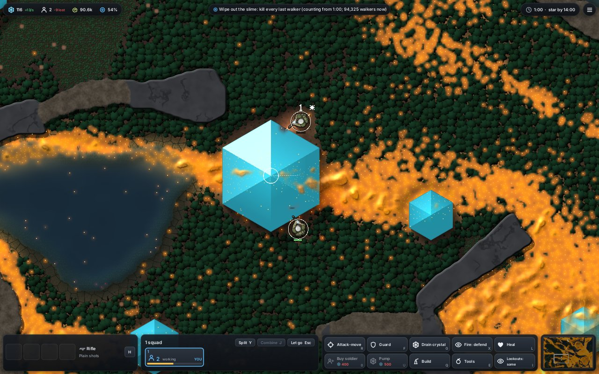
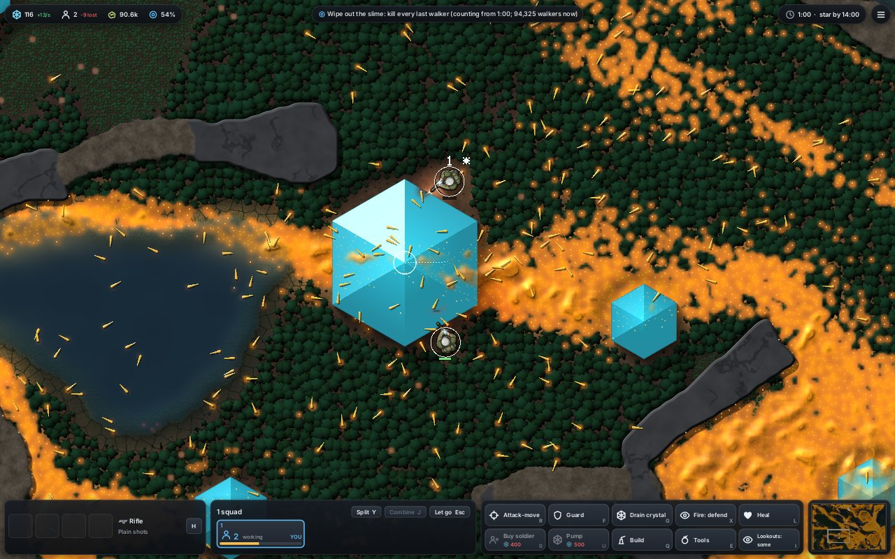

# The Sporer's spores in flight (2026-11-21)

Enemy, the look lane's ask for per-slime looks. Every flying spore now
writes its flight into its walker's fourth word (engine.wgsl's `fly`), as
flung and sown spores already did, so the view draws it as a gold bead with
a tail along its flight (view.wgsl's `draw_specks`) instead of a faint speck.
Only the Sporer (planet 5) fruits ordinary spores (`spore_rate`,
`spore_burst`), so no other planet changes.

Planet 5, run seed 1, greedy hand, 1:00, zoom 6 (`look=DIR run=1:5
mode=squads hand=greedy at=60`), lavapipe:

| Before | After |
|---|---|
|  |  |

The Sporer throws a lot of spores: at 1:00 the frame holds a few hundred in
flight, so it reads as a spore rain over the forest. The look lane may thin
or shrink spores in the view if it is too busy.
